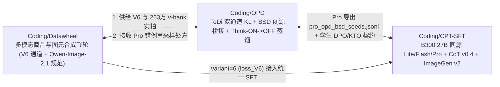

# AGENTS.md — CPT-SFT 编码代理工作约定

本文件为在 `Coding/CPT-SFT` 仓库内工作的 AI 编码代理提供项目结构、跨项目联动关系（与 `Coding/Datawheel`、`Coding/OPD` 互通）及验证规范。**修改代码或文档前请先阅读本文件与上层 [`~/Documents/AGENTS.md`](../../AGENTS.md)。**

---

## 1. 仓库定位与跨项目互通关系

`CPT-SFT`（GitHub: [qianlvguang/CPT-SFT](https://github.com/qianlvguang/CPT-SFT)）是工作区的**训练、推理与领域对齐中枢**，与同级目录 [`../Datawheel/`](../Datawheel/README.md)、[`../OPD/`](../OPD/README.md) 构成完整闭环：



| 关联项目 | 相对路径 | 互通接口与数据契约 |
|---|---|---|
| **`Coding/Datawheel`** | `../Datawheel/` | 1. **训练与生图契约**：Datawheel 导出的 V6 parquet 接入 [`training/flash/refactor_v1_v4_pipeline.py`](training/flash/refactor_v1_v4_pipeline.py)；[`training/flash/build_v2_image_pipeline.py`](training/flash/build_v2_image_pipeline.py) 对齐 `Datawheel/docs/QWEN_IMAGE_2_1_PIPELINE.md` 的 Edit/I2I 与 VLM/OCR 门禁。<br>2. **边查验边造数**：`tools/diagnose_and_refill_v6.py` 输出反哺 Pro 多模态 DPO/KTO 与定向补采。 |
| **`Coding/OPD`** | `../OPD/` | 1. **Think-ON→OFF 上下文蒸馏与闭源桥接**：[`training/pro/enhance_flash_to_pro.py`](training/pro/enhance_flash_to_pro.py) 导出 `pro_opd_bsd_seeds.jsonl`（`think_on_to_off_context_distill`）与 `pro_dpo_kto_pairs.jsonl`，交由 `../OPD/bsd_api_bridge.py` 与 `../OPD/kl_objectives.py` 对齐无思考低延迟部署表现。<br>2. **深度特化 LoRA 路由**：`../OPD/depth_lora_router.py` 的 `--target_regex` 可直接接入 `training/swift/train_*.sh`。 |

---

## 2. 目录结构与职责边界

| 目录 | 职责 | 关键入口 |
|---|---|---|
| `training/lib/` & `training/cpt_27b/` | **B300 校准发射底盘**：全局 `MAX_LENGTH=8192`、`TP=4`、`--gradient_accumulation_fusion false`（APEX 修复）、TE `sm_103` 预检；支持 `lite` (`MBS=1/GBS=4`)、`flash` (`WSD linear, MBS=2/GBS=16`)、`pro` (`6e-6`)、`pro_inc` (`cosine 5e-6`) 与兼容 `stage1`/`stage2` | [`training/lib/hw_b300.sh`](training/lib/hw_b300.sh)、[`training/cpt_27b/run_cpt_27b_b300.sh`](training/cpt_27b/run_cpt_27b_b300.sh)、[`training/cpt_27b/train_cpt_qwen3_5_27b_megatron.sh`](training/cpt_27b/train_cpt_qwen3_5_27b_megatron.sh) |
| `training/lite/` | **Phase A（Lite 按比例切片对照）**：默认从 Flash 四桶 Mid-Training 池整家族按 `15%` 切片（`val0`）避免 7-step 崩溃；保留 `LITE_MODE=sch_legacy` 兼容 | [`training/lite/slice_flash_to_lite.py`](training/lite/slice_flash_to_lite.py)、[`training/lite/build_cpt_from_sch.py`](training/lite/build_cpt_from_sch.py)、[`training/lite/run_lite_pipeline.sh`](training/lite/run_lite_pipeline.sh) |
| `training/flash/` | **Phase B（Flash 3 步骨干）**：CoT v0.4 知识内化 + `Clean Direct Twins` + `qa_midtrain_prose`；ImageGen v2 按域分区多图打包；单阶段 30/35/15/20 WSD Mid-Training（`synth<=25%`, `qa_prose<=15%`, zero raw ChatML/<think> in pt）；单轮双模 SFT | [`training/flash/gen_cot_from_qa.py`](training/flash/gen_cot_from_qa.py)、[`training/flash/build_v2_image_pipeline.py`](training/flash/build_v2_image_pipeline.py)、[`training/flash/build_mm_wiki_cpt.py`](training/flash/build_mm_wiki_cpt.py)、[`training/flash/refactor_v1_v4_pipeline.py`](training/flash/refactor_v1_v4_pipeline.py)、[`training/flash/run_flash_pipeline.sh`](training/flash/run_flash_pipeline.sh) |
| `training/pro/` | **Phase C（Pro 同源程序增强 + 多轮演化）**：复用 Flash 原始池执行 4 项程序增强（密度筛选、跨模态对齐、双模 Canary + WiSE-FT `0.8*CPT+0.2*Base`、学生 DPO/KTO + OPD Think-OFF 蒸馏）+ 多轮单调账本 `iteration_ledger.json`（`sft_overlap=0`） | [`training/pro/enhance_flash_to_pro.py`](training/pro/enhance_flash_to_pro.py)、[`training/pro/error_cluster_miner.py`](training/pro/error_cluster_miner.py)、[`training/pro/run_pro_pipeline.sh`](training/pro/run_pro_pipeline.sh) |
| `training/swift/` & `archive/` | 单卡 / Flash-Next 独立 SFT 入口；H200 / QSA 历史归档 | [`archive/README.md`](archive/README.md) |
| `docs/training_plans/` & `tools/` & `tests/` | 分层方案文档、工作流图渲染器与标准库全量测试 | [`docs/training_plans/README.md`](docs/training_plans/README.md) |

---

## 3. 编码与工程铁律

1. **零硬编码本机路径**；Python 使用 `Path(__file__).resolve().parent...`，Shell 使用 `SCRIPT_DIR` 与环境变量覆盖。
2. **默认安全 Dry-Run（`DRY_RUN=1` / 缺省不传 `--launch`）**。
3. **防泄漏、防 Thinking-OFF 崩溃与防 CPT QA 污染**：
   - `doc_family_id` / `template_family_id` 在跨阶段与多轮账本中单调累计隔离，强制 `sft_overlap == 0` 与 `eval_family_overlap == 0`；
   - 禁止 `flag`/`geo` 走纯 T2I；禁止单条 doc 复制 10 行（必须 `doc_text_repeat == 1` 多图打包）；
   - 禁止 raw ChatML / `<think>` 进入 `megatron pt`，必须转为 `ch_qa_knowledge_prose`（`<= 15%`）；
   - Direct 桶 `>= 80%` 为来自通过 CoT 的高质 `Clean Direct Twins`，严禁仅由失败降级垃圾垄断直答模式。
4. **不将权重、大体积数据或运行临时目录（`output_demo/`、`__pycache__/`）纳入 Git**。

---

## 4. 提交前必跑验证命令

```bash
python3 -m py_compile training/lite/*.py training/flash/*.py training/pro/*.py training/pro/montessori/*.py tests/*.py tools/*.py
python3 tests/test_lite_flash_pro_architecture.py -v
python3 tests/test_b300_mm_cpt_pipeline.py -v
python3 tests/test_unified_v1_v4_pipeline.py -v
python3 tests/test_montessori_pipeline.py -v
python3 tests/test_recommended_pipeline.py -v
bash training/cpt_27b/run_cpt_27b_b300.sh flash --model /data/autovision-cfs/autovision-notebook/algo4/models/Qwen3.5-27B
WORK_DIR=/tmp/cpt_sft_lite_check DEMO=1 DRY_RUN=1 bash training/lite/run_lite_pipeline.sh
WORK_DIR=/tmp/cpt_sft_flash_check DEMO=1 DRY_RUN=1 bash training/flash/run_flash_pipeline.sh
WORK_DIR=/tmp/cpt_sft_pro_check DEMO=1 DRY_RUN=1 bash training/pro/run_pro_pipeline.sh
DRY_RUN=1 bash training/pro/montessori/run_montessori_pipeline.sh
rm -rf training/pro/montessori/output_demo /tmp/cpt_sft_*_check
git status -s
```
