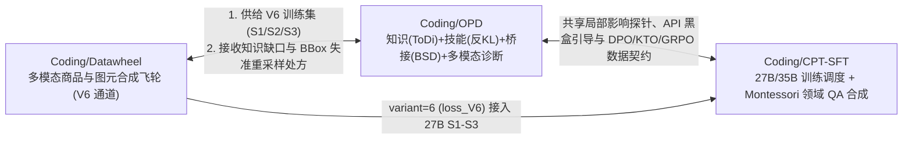

# AGENTS.md — CPT-SFT 编码代理工作约定

本文件为在 `Coding/CPT-SFT` 仓库内工作的 AI 编码代理提供项目结构、跨项目联动关系（与 `Coding/Datawheel`、`Coding/OPD` 互通）及验证规范。**修改代码或文档前请先阅读本文件与上层 [`~/Documents/AGENTS.md`](../../AGENTS.md)。**

---

## 1. 仓库定位与跨项目互通关系

`CPT-SFT`（GitHub: [qianlvguang/CPT-SFT](https://github.com/qianlvguang/CPT-SFT)）是工作区的**训练、推理与领域对齐中枢**，与同级目录 [`../Datawheel/`](../Datawheel/README.md)、[`../OPD/`](../OPD/README.md) 构成完整闭环：



| 关联项目 | 相对路径 | 互通接口与数据契约 |
|---|---|---|
| **`Coding/Datawheel`** | `../Datawheel/` | 1. **训练输入**：Datawheel 导出的 V6 parquet（`messages / images / enable_thinking / sample_id / cate_id / variant=6`）直接接入本仓库 [`training/qwen35_27b/`](training/qwen35_27b/README.md) 的 S1–S3 累计 LoRA 管线（插件自动映射 `variant=6 -> loss_V6`）。<br>2. **边查验边造数**：Datawheel 的 [`tools/diagnose_and_refill_v6.py`](../Datawheel/tools/diagnose_and_refill_v6.py) 导出 `vlm_datawheel_{sft,dpo,kto}.jsonl`，可直接传给本仓库的 [`training/swift/train_qwen35_27b_swift.sh`](training/swift/train_qwen35_27b_swift.sh) 或 [`training/domain_adaptation/montessori/train_teacher_dpo_swift.sh`](training/domain_adaptation/montessori/train_teacher_dpo_swift.sh)。 |
| **`Coding/OPD`** | `../OPD/` | 1. **在线蒸馏与闭源 API 桥接**：本仓库 [`training/domain_adaptation/montessori/`](training/domain_adaptation/montessori/README.md) 产出的 `student_grpo_prompts.jsonl` 与 API 专家解答，可交由 `../OPD/bsd_api_bridge.py` 执行桥接自蒸馏（BSD），或由 `../OPD/kl_objectives.py` 执行 ToDi 前/反向双通道 KL 蒸馏。<br>2. **深度特化 LoRA 路由**：`../OPD/depth_lora_router.py` 生成的 `--target_regex`（前中层管组合技能、末层管事实记忆）可直接传入本仓库 `training/swift/train_*.sh` 的 `LORA_SCOPE=regex TARGET_REGEX=...`。 |

---

## 2. 目录结构与职责边界

| 目录 | 职责 | 关键入口 |
|---|---|---|
| `training/qwen35_27b/` | H200×8 上 Qwen3.5-27B 多阶段（S1→S2→S3）累计 LoRA 主线，支持 V1–V6 多通道 Loss | [`train_s1_s3_recommended.py`](training/qwen35_27b/train_s1_s3_recommended.py)、[`train_s1_s3_recommended.sh`](training/qwen35_27b/train_s1_s3_recommended.sh) |
| `training/qsa_muon_35b_a3b/` | Qwen3.5-35B-A3B 的 QSA 注意力预热、CPT、SFT 与 Muon 优化器实验 | [`run_cpt_sft_qsa_35a3_h200x8.sh`](training/qsa_muon_35b_a3b/run_cpt_sft_qsa_35a3_h200x8.sh) |
| `training/swift/` | MS-SWIFT 训练入口（B300 Qwen3.8-Flash-Next Megatron SFT 与单卡/多卡 27B LoRA SFT） | [`train_qwen35_27b_swift.sh`](training/swift/train_qwen35_27b_swift.sh)、[`train_b300_swift.sh`](training/swift/train_b300_swift.sh) |
| `training/domain_adaptation/` | 法规/文章/Wiki 领域 CPT、有据 QA 合成、严谨引用风格 SFT 及 **Montessori-Instruct 闭环管线** | [`montessori/run_montessori_pipeline.sh`](training/domain_adaptation/montessori/run_montessori_pipeline.sh)、[`montessori/api_preference_synthesizer.py`](training/domain_adaptation/montessori/api_preference_synthesizer.py) |
| `inference/` | vLLM 0.32.0 / SGLang 在线推理服务脚本（B300 / RTX PRO 6000 / H200） | [`serve_qwen35_27b.sh`](inference/serve_qwen35_27b.sh)、[`serve_b300.sh`](inference/serve_b300.sh) |
| `docs/` | 模型架构指南、FP8/NVFP4 量化报告、领域训练计划与历史实验日志 | [`docs/training_plans/README.md`](docs/training_plans/README.md)、[`docs/model_guide/README.md`](docs/model_guide/README.md) |
| `tools/` & `tests/` | Safetensors 头部检查、正则覆盖检查及标准库回归测试套件 | [`tests/test_recommended_pipeline.py`](tests/test_recommended_pipeline.py)、[`tests/test_montessori_pipeline.py`](tests/test_montessori_pipeline.py) |

---

## 3. 编码与工程铁律

1. **零硬编码本机路径**：
   - Python 脚本统一使用 `Path(__file__).resolve().parent...` 定位仓库内资源；
   - Shell 脚本统一使用 `SCRIPT_DIR="$(cd "$(dirname "${BASH_SOURCE[0]}")" && pwd)"` 及环境变量覆盖（如 `WORK_DIR`、`DATASET`、`MODEL`、`OUTPUT_DIR`）。
2. **所有训练/服务脚本必须支持 `DRY_RUN=1`**：
   - 在无 GPU 的开发机或 CI 环境中，`DRY_RUN=1` 必须能够打印完整可执行的 `swift` / `megatron` / `docker` 命令并正常退出（exit code 0），不得触发模型下载或显存分配。
3. **数据防泄漏与硬核验优先**：
   - 在 Montessori-Instruct 与 QA 合成管线中，参考验证集 $\mathcal{D}_{\text{ref}}$ 必须与训练 `doc_family_id` 严格隔离；
   - 任何进入 DPO `chosen` ($x^+$)、KTO `label=true` 或 Student SFT 的样本，必须先通过程序级引文/子串核验（文本）或 BBox IoU/实体核验（多模态），严禁仅凭 Influence 分数放行幻觉样本。
4. **不将权重、大体积数据或运行临时目录纳入 Git**：
   - 测试或演示生成的临时目录（如 `output_demo/`、`__pycache__/`）在提交前必须清理干净。

---

## 4. 提交前必跑验证命令

在仓库根目录（`~/Documents/Coding/CPT-SFT`）下执行，全部通过后方可 `git commit` / `git push`：

```bash
# 1. Python 语法编译检查
python3 -m py_compile training/domain_adaptation/montessori/*.py tests/*.py tools/*.py

# 2. 标准库回归与单元测试
python3 tests/test_recommended_pipeline.py -v
python3 tests/test_montessori_pipeline.py -v

# 3. 训练与合成流水线 Dry-Run 检查
bash training/qwen35_27b/train_s1_s3_recommended.sh plan
DRY_RUN=1 bash training/domain_adaptation/montessori/run_montessori_pipeline.sh
DATASET=training/swift/example_sft.jsonl DRY_RUN=1 bash training/swift/train_qwen35_27b_swift.sh
DATASET=training/swift/example_sft.jsonl DRY_RUN=1 bash training/swift/train_b300_swift.sh

# 4. 清理演示临时产物并确认 git status 干净
rm -rf training/domain_adaptation/montessori/output_demo
git status -s
```
