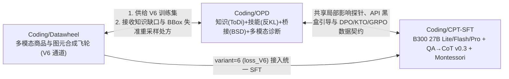

# AGENTS.md — CPT-SFT 编码代理工作约定

本文件为在 `Coding/CPT-SFT` 仓库内工作的 AI 编码代理提供项目结构、跨项目联动关系（与 `Coding/Datawheel`、`Coding/OPD` 互通）及验证规范。**修改代码或文档前请先阅读本文件与上层 [`~/Documents/AGENTS.md`](../../AGENTS.md)。**

---

## 1. 仓库定位与跨项目互通关系

`CPT-SFT`（GitHub: [qianlvguang/CPT-SFT](https://github.com/qianlvguang/CPT-SFT)）是工作区的**训练、推理与领域对齐中枢**，与同级目录 [`../Datawheel/`](../Datawheel/README.md)、[`../OPD/`](../OPD/README.md) 构成完整闭环：



| 关联项目 | 相对路径 | 互通接口与数据契约 |
|---|---|---|
| **`Coding/Datawheel`** | `../Datawheel/` | 1. **训练输入**：Datawheel 导出的 V6 parquet（`messages / images / enable_thinking / sample_id / cate_id / variant=6`）接入 [`training/flash/refactor_v1_v4_pipeline.py`](training/flash/refactor_v1_v4_pipeline.py) 统一 SFT。<br>2. **边查验边造数**：Datawheel 的 [`tools/diagnose_and_refill_v6.py`](../Datawheel/tools/diagnose_and_refill_v6.py) 导出 `vlm_datawheel_{sft,dpo,kto}.jsonl`，可直接传给 [`training/swift/train_qwen35_27b_swift.sh`](training/swift/train_qwen35_27b_swift.sh) 或 [`training/pro/montessori/train_teacher_dpo_swift.sh`](training/pro/montessori/train_teacher_dpo_swift.sh)。 |
| **`Coding/OPD`** | `../OPD/` | 1. **在线蒸馏与闭源 API 桥接**：[`training/pro/montessori/`](training/pro/montessori/README.md) 产出的 `student_grpo_prompts.jsonl` 与 [`training/flash/gen_cot_from_qa.py`](training/flash/gen_cot_from_qa.py) 的 API CoT 轨迹，可交由 `../OPD/bsd_api_bridge.py` 执行桥接自蒸馏（BSD），或由 `../OPD/kl_objectives.py` 执行 ToDi 双通道 KL 蒸馏。<br>2. **深度特化 LoRA 路由**：`../OPD/depth_lora_router.py` 生成的 `--target_regex` 可直接传入本仓库 `training/swift/train_*.sh` 的 `LORA_SCOPE=regex TARGET_REGEX=...`。 |

---

## 2. 目录结构与职责边界

| 目录 | 职责 | 关键入口 |
|---|---|---|
| `training/lib/` & `training/cpt_27b/` | **B300 公共层与权威发射底盘**：固化 `TP=4`、`MBS=4`、`GBS=32`、`--gradient_accumulation_fusion false`（APEX 修复）、TE `sm_103` 预检与 `--launch` 门禁 | [`training/lib/_core.sh`](training/lib/_core.sh)、[`training/lib/hw_b300.sh`](training/lib/hw_b300.sh)、[`training/cpt_27b/run_cpt_27b_b300.sh`](training/cpt_27b/run_cpt_27b_b300.sh)、[`training/cpt_27b/train_cpt_qwen3_5_27b_megatron.sh`](training/cpt_27b/train_cpt_qwen3_5_27b_megatron.sh) |
| `training/lite/` | **Phase A（Lite 增益对照线）**：`sch` 96 模板 iso 改造（以 `elements` 判通道并将 `label` 降级为审计字段）、`bundle_lite_v3_all·val0` 与双臂外部 OOD SFT 对照 | [`training/lite/build_cpt_from_sch.py`](training/lite/build_cpt_from_sch.py)、[`training/lite/run_lite_pipeline.sh`](training/lite/run_lite_pipeline.sh) |
| `training/flash/` | **Phase B（Flash 全量 WSD + QA→CoT v0.3）**：全量 WSD 两阶段构建（含 `sch v2.3` 并入）、QA→CoT v0.3 八道门控与直答降级、三方对照统一 SFT | [`training/flash/build_mm_wiki_cpt.py`](training/flash/build_mm_wiki_cpt.py)、[`training/flash/gen_cot_from_qa.py`](training/flash/gen_cot_from_qa.py)、[`training/flash/refactor_v1_v4_pipeline.py`](training/flash/refactor_v1_v4_pipeline.py)、[`training/flash/run_flash_pipeline.sh`](training/flash/run_flash_pipeline.sh) |
| `training/pro/` | **Phase C（Pro 错例闭环演进）**：四类错例归因（固定权重补索引/改路由门控）、`50/30/20` 增量 CPT、`sft_overlap=0` 隔离与 Montessori-Instruct 闭环 | [`training/pro/error_cluster_miner.py`](training/pro/error_cluster_miner.py)、[`training/pro/run_pro_pipeline.sh`](training/pro/run_pro_pipeline.sh)、[`training/pro/montessori/run_montessori_pipeline.sh`](training/pro/montessori/run_montessori_pipeline.sh) |
| `training/swift/` | **单模型独立 SFT 入口**：`Qwen3.8-Flash-Next` B300 单独 LoRA 尝试与单卡 27B SFT | [`training/swift/train_qwen35_27b_swift.sh`](training/swift/train_qwen35_27b_swift.sh)、[`training/swift/train_b300_swift.sh`](training/swift/train_b300_swift.sh) |
| `archive/` | **历史归档**：已退出的 H200 `ms-swift 4.3.2` 三阶段推荐线与 35B-A3B QSA/Muon 实验 | [`archive/README.md`](archive/README.md) |
| `docs/training_plans/` | **按阶段分目录的方案文档**：`lite/`、`flash/`、`pro/` 与总纲 `online_ip_template_cpt.md` | [`docs/training_plans/README.md`](docs/training_plans/README.md) |
| `tools/` & `tests/` | Safetensors 检查、正则检查、工作流渲染及全套标准库回归测试 | [`tests/test_lite_flash_pro_architecture.py`](tests/test_lite_flash_pro_architecture.py)、[`tests/test_b300_mm_cpt_pipeline.py`](tests/test_b300_mm_cpt_pipeline.py) |

---

## 3. 编码与工程铁律

1. **零硬编码本机路径**：
   - Python 脚本统一使用 `Path(__file__).resolve().parent...` 定位仓库内资源；
   - Shell 脚本统一使用 `SCRIPT_DIR="$(cd "$(dirname "${BASH_SOURCE[0]}")" && pwd)"` 及环境变量覆盖（如 `WORK_DIR`、`DATASET`、`MODEL`、`OUTPUT_DIR`、`AUTOVISION_ROOT`）。
2. **所有训练/服务脚本默认安全 Dry-Run（`DRY_RUN=1` / 缺省无 `--launch`）**：
   - 在无 GPU 的开发机或 CI 环境中，`DRY_RUN=1`（或 `run_cpt_27b_b300.sh` 未传 `--launch`）必须能够打印完整可执行命令并正常退出（exit code 0），不得触发模型下载或显存分配。
3. **数据防泄漏、硬核验与降级零污染**：
   - `doc_family_id` 与 `template_family_id` 必须严格隔离（Pro 阶段强制断言 `sft_overlap == 0`）；
   - `sch` 改造必须以 `elements` 实际内容判通道（`label` 降级为审计字段）；
   - QA→CoT v0.3 未通过八道门的样本严禁拼接 Quote 兜底，必须置 `reasoning=""` 且 `enable_thinking=false` 降级至直答桶。
4. **不将权重、大体积数据或运行临时目录纳入 Git**：
   - 测试或演示生成的临时目录（如 `output_demo/`、`__pycache__/`）在提交前必须清理干净。

---

## 4. 提交前必跑验证命令

在仓库根目录（`~/Documents/Coding/CPT-SFT`）下执行，全部通过后方可 `git commit` / `git push`：

```bash
# 1. Python 语法编译检查
python3 -m py_compile training/lite/*.py training/flash/*.py training/pro/*.py training/pro/montessori/*.py tests/*.py tools/*.py

# 2. 标准库回归与单元测试
python3 tests/test_lite_flash_pro_architecture.py -v
python3 tests/test_b300_mm_cpt_pipeline.py -v
python3 tests/test_unified_v1_v4_pipeline.py -v
python3 tests/test_montessori_pipeline.py -v
python3 tests/test_recommended_pipeline.py -v

# 3. 训练与合成流水线 Dry-Run 检查
bash training/cpt_27b/run_cpt_27b_b300.sh lite --model /data/autovision-cfs/autovision-notebook/algo4/models/Qwen3.5-27B
WORK_DIR=/tmp/cpt_sft_lite_check DEMO=1 DRY_RUN=1 bash training/lite/run_lite_pipeline.sh
WORK_DIR=/tmp/cpt_sft_flash_check DEMO=1 DRY_RUN=1 bash training/flash/run_flash_pipeline.sh
WORK_DIR=/tmp/cpt_sft_pro_check DEMO=1 DRY_RUN=1 bash training/pro/run_pro_pipeline.sh
DRY_RUN=1 bash training/pro/montessori/run_montessori_pipeline.sh
DATASET=training/swift/examples/example_sft.jsonl DRY_RUN=1 bash training/swift/train_qwen35_27b_swift.sh
DATASET=training/swift/examples/example_sft.jsonl DRY_RUN=1 bash training/swift/train_b300_swift.sh
bash archive/training/qwen35_27b_h200/train_s1_s3_recommended.sh plan

# 4. 清理演示临时产物并确认 git status 干净
rm -rf training/pro/montessori/output_demo /tmp/cpt_sft_*_check
git status -s
```
