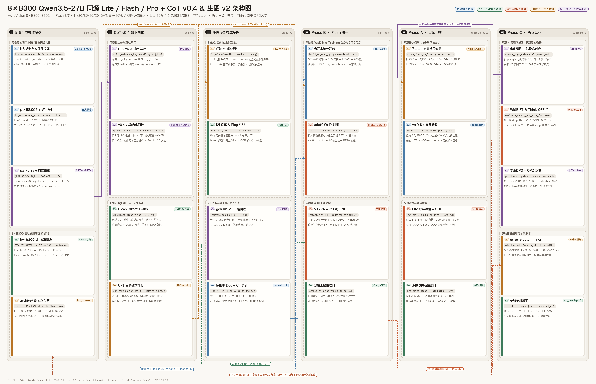

# CPT-SFT：Qwen3.5-27B 同源三档域适应（Lite / Flash / Pro）、CoT v0.4 与生图 v2

围绕 **AutoVision 8×B300（`sm_103`）`Qwen3.5-27B`** 电商侵权 / IP 认知域适应战役，采用「**公共 B300 校准发射底盘 (`8192` 序列、`TP=4`) + 同源递进 `Lite ← Flash → Pro` 三档管线**」架构；历史 H200 与 35B-A3B QSA/Muon 已整体归档至 [`archive/`](archive/README.md)。



> 整个 `CPT-SFT/` 是一个 Git 仓库，对应 [qianlvguang/CPT-SFT](https://github.com/qianlvguang/CPT-SFT)。AI 编码代理在此仓库工作前请先阅读 [AGENTS.md](AGENTS.md)。

## 目录架构

```text
CPT-SFT/
├── AGENTS.md                        # AI 编码代理工作约定与跨项目（Datawheel / OPD）互通说明
├── training/
│   ├── lib/                         # B300 公共硬件层（_core.sh, hw_b300.sh: TP4/MBS2/GBS16/8192）
│   ├── cpt_27b/                     # 权威 B300 发射链（run_cpt_27b_b300.sh: lite|flash|pro|pro_inc|stage1|stage2）
│   ├── lite/                        # Phase A：Lite 按比例切片对照（15% Flash 整家族分层切片, MBS=1/GBS=4/8192, val0）
│   ├── flash/                       # Phase B：Flash 3 步骨干（CoT v0.4 内化 + 生图 v2 多图打包 + 单阶段 WSD + 统一 SFT）
│   ├── pro/                         # Phase C：Pro 同源 4 项程序增强 + 多轮 iteration_ledger.json + OPD Think-OFF 蒸馏
│   └── swift/                       # 单模型独立 SFT 入口（Flash-Next B300 尝试与单卡 27B）
├── archive/                         # 历史归档（H200 V1～V4 推荐线、H200 纯文本草案、35B-A3B QSA/Muon）
├── inference/                       # vLLM 0.32.0 B300 / RTX PRO 6000 服务脚本
├── environment/                     # CUDA/PyTorch 架构检查与编译说明
├── docs/
│   └── training_plans/
│       ├── lite/                    # Phase A Runbook（含 B300 7-steps 根因修复）
│       ├── flash/                   # Phase B CoT v0.4 详案、生图 v2 规范、Mid-Training 与工作流图
│       └── pro/                     # Phase C 同源程序增强与多轮闭环演进
├── tools/                           # 权重头部读取、模块正则检查与工作流渲染器
└── tests/                           # 全套标准库单元测试与 Dry-Run 回归套件
```

## 核心升级亮点（2026-11-19 v2.0 架构）

| 维度 | 旧方案病灶 | 升级后设计 |
|---|---|---|
| **B300 步数与序列长度** | 95% 短 `sch` + `GBS=32 * 16384 = 524K/step` 导致 7 steps 即刷完 | 全局默认 `8192`；Lite `MBS=1/GBS=4`（32.8K/step → 100~150 steps）；Flash/Pro `MBS=2/GBS=16`（131K/step） |
| **QA→CoT v0.4（知识内化）** | `5k_v2` 依赖 RAG `[S1]` 引用且 227k 含 80k 重复 | 先去重至 147k；规则进 `user`（`[R1]`），实体本体进 `reasoning` 第一人称直出；衍生 `Clean Direct Twins`（`>=80%` 直答桶）防 Thinking=OFF 崩溃 |
| **CPT 阶段 QA 风险管控** | 生喂 ChatML / `<think>` 污染角色模版并冻结规则 | 强制转换 `qa_midtrain_prose` 百科散文（零 `<think>`/零 ChatML）、硬上限 `<=15%`、全量剔除 SFT/eval 家族（`overlap=0`） |
| **生图 v2（按域分区+多图）** | v1 无差别生图且设想 1 doc 拆 10 行易过拟合 | `logo`/`audit` 停；`dex` `mm=True` 走 I2I；`flag` 禁纯 T2I；`move` 节流；Top 2~4 图打包进单条 doc（`doc_text_repeat=1`），合成图全局 `<=25%` |
| **Lite / Flash / Pro 关系** | Flash 冗余两阶段 + Pro 独立零散 | **Flash** 去冗余 3 步 → **Lite** `slice_flash_to_lite.py`（15% 整家族分层）→ **Pro** `enhance_flash_to_pro.py`（同源 4 项程序增强 + Think-ON→OFF OPD + `iteration_ledger.json`） |

## 本地检查（无 GPU / 零下载）

```bash
python3 tests/test_lite_flash_pro_architecture.py -v
python3 tests/test_b300_mm_cpt_pipeline.py -v
python3 tests/test_unified_v1_v4_pipeline.py -v
python3 tests/test_montessori_pipeline.py -v
python3 tests/test_recommended_pipeline.py -v
DEMO=1 DRY_RUN=1 bash training/lite/run_lite_pipeline.sh
DEMO=1 DRY_RUN=1 bash training/flash/run_flash_pipeline.sh
DEMO=1 DRY_RUN=1 bash training/pro/run_pro_pipeline.sh
bash training/cpt_27b/run_cpt_27b_b300.sh flash --model /data/autovision-cfs/autovision-notebook/algo4/models/Qwen3.5-27B
DRY_RUN=1 bash inference/serve_qwen35_27b.sh
```
