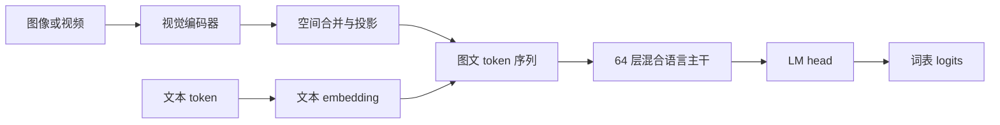

# Qwen3.5-27B 模型结构与训练落点

核对日期：2026-11-08。本文针对官方 `Qwen/Qwen3.5-27B`，结构字段和权重元数据已在线核对；没有加载完整模型或运行 GPU。模型仓库 revision 为 `fc05daec18b0a78c049392ed2e771dde82bdf654`，抽取结果、索引字节数和源码 revision 记录在 [来源快照](../research_snapshots/qwen35_27b_source_summary_2026_11_08.json)。

## 1. 整体数据流

27B 是稠密视觉语言模型。图像/视频先经过视觉编码器和 merger，得到与文本隐藏维度一致的视觉 token；语言主干交替使用 Gated DeltaNet 和 Gated Attention，每层都配稠密 FFN。27B 没有 MoE 专家路由，也没有本项目 Flash-Next 方案中的 PLE 大表。[官方模型卡](https://huggingface.co/Qwen/Qwen3.5-27B#model-overview)



语言主干的 16 个周期各包含三个 `Gated DeltaNet → FFN` 层和一个 `Gated Attention → FFN` 层。全注意力位于零基编号 3、7、11……63，其余 48 层为 GDN。自训 JEV 的额外决策头或选项读取逻辑需要另外核对；它们不属于此基础结构定义。

## 2. 官方配置中的关键尺寸

| 部分 | 配置 |
|---|---|
| 架构 | `Qwen3_5ForConditionalGeneration` |
| 语言主干 | 64 层，隐藏维度 5120，FFN 中间维度 17408 |
| GDN | Q/K 各 16 头，V 48 头；K/V 头维度均为 128；卷积核宽 4 |
| 全注意力 | Q 24 头、KV 4 头；头维度 256；输出门控开启 |
| 词表与输出 | 248320；输入 embedding 与 LM head 不共享权重 |
| 位置编码 | 原生长度 262144；部分旋转比例 0.25；mRoPE 分段 `[11,11,10]` |
| 视觉编码器 | 27 层，隐藏维度 1152，16 个注意力头，中间维度 4304 |
| 视觉输入与合并 | patch 16，时间 patch 2，空间合并 2；投影输出 5120 |
| MTP / 状态 | 配置含 1 层 MTP；`mamba_ssm_dtype=float32` |

来源：[固定 revision 的官方配置](https://huggingface.co/Qwen/Qwen3.5-27B/blob/fc05daec18b0a78c049392ed2e771dde82bdf654/config.json)。原 JEV 方案曾把 27B 的 V 头数记成 32，此处更正为 **48**；35B-A3B 的结构参数不能移植到 27B 表格。

`transformers_version` 是保存配置时的版本标记，不能用它证明该版本已完整支持当前推理、量化或 MTP 路径。百万长度属于扩展上下文配置，也不能仅凭模型卡推定现有服务能够以同等质量和吞吐运行。

## 3. 线性投影形状与模块名

以下尺寸依据配置和已固定的 [Transformers 实现](https://github.com/huggingface/transformers/blob/a6f5c8676b158c367dc3389f68dde7a97fb619d6/src/transformers/models/qwen3_5/modeling_qwen3_5.py) 推导，采用 `输入维度 → 输出维度`。这里描述 HF 模块；vLLM 和 Megatron 可能进行融合、分片或重命名，实际 LoRA 目标应检查目标后端的模块列表。

| 路径后缀 | 投影尺寸与用途 |
|---|---|
| `linear_attn.in_proj_qkv` | 5120 → 10240，其中 Q/K 各 2048、V 6144 |
| `linear_attn.in_proj_z` | 5120 → 6144，输出门控分支 |
| `linear_attn.in_proj_a`、`in_proj_b` | 各 5120 → 48，递推衰减与更新分支 |
| `linear_attn.out_proj` | 6144 → 5120 |
| `self_attn.q_proj` | 5120 → 12288，同时承载 query 和 gate，拆分后各 6144 |
| `self_attn.k_proj`、`v_proj` | 各 5120 → 1024 |
| `self_attn.o_proj` | 6144 → 5120 |
| `mlp.gate_proj`、`up_proj` | 各 5120 → 17408，构成带门控的稠密 FFN |
| `mlp.down_proj` | 17408 → 5120 |

这解释了两个常见误判：全注意力的 `24 × 256 = 6144` 不必等于隐藏维度 5120；`gate_proj` 是 FFN 门控，并不表示存在 MoE router。`q_proj` 的两倍宽度也来自输出门控，不能当成模型尺寸异常。

视觉 merger 把 2×2 个空间 patch 的特征合并，内部宽度按配置推导为 `4 × 1152 = 4608`，再映射到语言空间。实际视觉 token 数由 processor 的 `grid_thw` 决定，空间合并后的数量为 `grid_t × grid_h × grid_w / 4`；不能把每张图固定记为 1000 或 2000 token。输入缩放、帧数和多图数量会改变训练长度与推理缓存需求。

## 4. 参数主要分布在哪里

以下为配置级手算，不是运行时显存统计：

| 部分 | 推导 | 约参数量 |
|---|---|---:|
| 64 层稠密 FFN 的三组矩阵 | `64 × 3 × 5120 × 17408` | 17.113B |
| 16 层全注意力线性矩阵 | `16 × [5120 × (2×6144 + 2×1024) + 6144×5120]` | 1.678B |
| embedding 与 LM head | `2 × 248320 × 5120` | 2.543B |

因此，FFN 是压缩权重的重要目标，但保留 GDN、视觉栈和输出层时，整模不会得到纯 4-bit 的理论体积。量化后的实际 tensor 字节数、保留模块和 scale 都应单独统计，见 [量化方案](qwen35_27b_quantization.md)。

## 5. KV cache 与 GDN 状态分别计算

假设 TP1、单条序列、没有前缀共享，全注意力 K/V 使用 BF16：

```text
每 token KV = 16 层 × 2(K/V) × 4 个 KV 头 × 256 × 2 字节
            = 65536 字节 = 64 KiB
```

| 总序列长度 | 全注意力 BF16 KV 理论值 |
|---:|---:|
| 8192 | 0.5 GiB |
| 16384 | 1 GiB |
| 32768 | 2 GiB |
| 131072 | 8 GiB |
| 262144 | 16 GiB |

只按递推矩阵计算，GDN 的一个 FP32 状态为 `48 层 × 48 个 V 头 × 128 × 128 × 4` 字节，即 **144 MiB/序列**。这些都是依据配置的推导，不含卷积状态、状态检查点、prefix cache、并发副本、block 对齐、视觉缓存、激活、CUDA graph 和工作区。引擎可能保存多个状态副本；不能把 144 MiB 当作 vLLM 的实际 Mamba 缓存总额。

降低 KV 精度只影响对应缓存，不能据此把 GDN 状态、模型权重或服务总显存一起按比例缩小。[vLLM 0.32 KV 量化说明](https://docs.vllm.ai/en/v0.32.0/features/quantization/quantized_kvcache/)

## 6. 与本仓库训练方案的对应关系

- **视觉适配**：ViT 和 merger 是两个独立训练对象。推荐流水线保留历史异构 LoRA 规则，并在后续阶段加载旧 adapter 后冻结视觉增量；整理目录没有改变这套行为。
- **LLM 适配**：要覆盖 GDN、全注意力和 FFN，应检查实际注入模块；只写 `q_proj/v_proj` 不能代表覆盖了 48 层 GDN。
- **MTP**：配置声明、checkpoint 中存在张量、框架加载这些张量、引擎能启用投机解码是四件不同的事。量化导出时应核对是否丢失 MTP；LLM Compressor 的对应示例专门补存它。
- **JEV**：如果读取自定义 head，应保留其权重、读取位置和校准参数；若读取选项 token，则保持同一 prompt、token ID 和候选归一化方式。原生聊天模板不能替代训练协议。

可运行入口见 [27B 推荐路线](../../training/qwen35_27b/README.md)、[MS-SWIFT 微调](../../training/swift/README.md) 和 [推理说明](../../inference/README.md)。以上结构核对不等同于这些训练与服务路径已在目标 GPU 验证。
