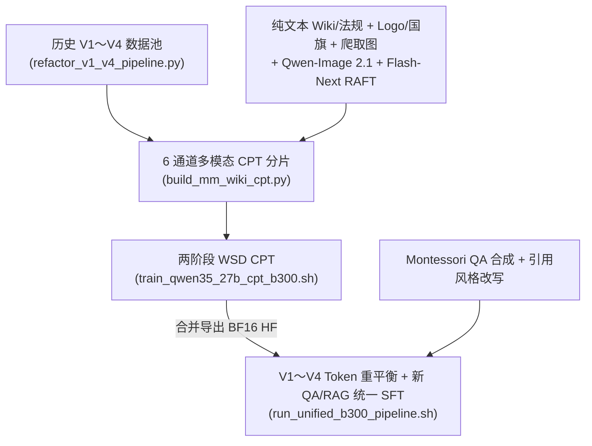

# 领域知识、CPT 与 QA/风格训练方案总览

> **阅读导航**：为避免早期草案与当前主线混淆，本目录按**「当前 B300 统一主线 → 下游 QA/风格专题 → 早期草案与硬件调研归档」**分层组织。

## 一、当前 B300 统一主线（优先阅读）

面向 `Qwen3.5-27B`（8×B300），配合 `Qwen3.8-Flash-Next` RAG 检索中枢与 `Qwen-Image 2.1` 生图/反事实管线；可执行代码与示例位于 [`training/domain_adaptation/`](../../training/domain_adaptation/README.md)：

| 方案 | 解决什么问题 |
|---|---|
| [B300 双模型多模态 Wiki+RAG CPT](b300_multimodal_wiki_rag_cpt_plan.md) | B300 上 27B vs Flash-Next 训练可行性评估、Qwen-Image 2.1 生图/反事实、6 通道配比与 WSD 课程 |
| [V1～V4 融入 CPT 与统一 QA-SFT 重构方案](unified_v1_v4_cpt_qa_pipeline.md) | 历史 V1～V4 三元去重分流进 CPT 回放/RAFT，及与新 QA 按监督 Token 重平衡接入统一 SFT |

## 二、下游 QA 合成与风格收尾专题

| 方案 | 解决什么问题 |
|---|---|
| [推理生成 QA](qa_synthesis_plan.md) | 如何从来源生成题目、程序/独立核验与导出 Montessori SFT/DPO/KTO 数据 |
| [回答风格 SFT](answer_style_sft_plan.md) | 如何学习严谨详尽、带 `[S1]` 依据引用的回答习惯（推理端配合可更新 RAG 库） |

## 三、早期设计基线与专项硬件调研（归档参考）

| 方案 | 定位说明 |
|---|---|
| [早期原文 CPT 草案](domain_cpt_plan.md) | 2026-11-08 针对 H200×8 纯文本 100M 原型草案；B300 多模态 Wiki+RAG 落地已被第一部分两篇方案演进替代，保留其中文档登记与切块通用准则 |
| [27B 进阶训练与管理](qwen35_27b_advanced_training_and_management.md) | QAT、NF4 QLoRA、WSD 公式与新 Megatron 堆栈调研参考 |
