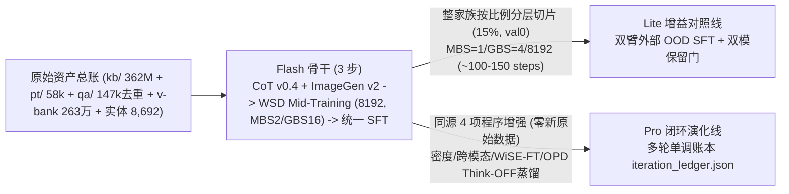

# 领域知识、CPT 与 QA/CoT 训练方案总览

围绕实际线上 IP 审核模板与 **AutoVision 8×B300（`sm_103`）Qwen3.5-27B** 战役，仓库已重构为 **同源资产驱动的三档递进架构**：
- **Flash**：去冗余三步骨干（Step 1 数据准备 CoT v0.4 + 生图 v2 + V1~V4 → Step 2 单阶段 Instruct-Aware WSD Mid-Training 30/35/15/20 混合 → Step 3 单轮双模统一 SFT 7:3 Think-ON/Clean-Direct）；
- **Lite**：Flash 同源 4 桶整家族按比例分层切片（默认 `15%`、`val0`），修正 B300 batch（`MBS=1, GBS=4, MAX_LENGTH=8192` → 100~150 steps 彻底告别 7-step 崩溃）；
- **Pro**：与 Flash **完全共用同一套原始/基础产线数据**，通过 4 项程序化增强（密度/长尾精炼 + 跨模态锚点对齐 + 双模 Canary/WiSE-FT `0.8*CPT+0.2*Base` + Think-ON→OFF OPD 蒸馏）+ 多轮单调台账（`iteration_ledger.json`）拉升上限；历史 H200 / QSA 已归档至 [`archive/`](../../archive/README.md)。

- 三档工作流程总纲：[Lite、Flash 与 Pro 工作流程](online_ip_template_cpt.md)

## 一、Phase A：Lite 增益对照 ([`lite/`](lite/README.md))

| 文档 / 脚本 | 解决什么问题 |
|---|---|
| [`training/lite/slice_flash_to_lite.py`](../../training/lite/slice_flash_to_lite.py) | 按 `doc_family_id` 从 Flash 四桶 Mid-Training 池严格按比例切片（15%，`val0`），并计算 B300 `MBS=1/GBS=4/8192` 步数投影 |
| [CPT-27B 战役 Runbook（lite 增益对照线）](lite/cpt_27b_runbook.md) | `7 steps` 根因复盘（95% `sch` 短行 + `GBS=32*16384`）、B300 实训超参校准、`sm_103` TE/APEX 修复 |
| [`training/cpt_27b/run_cpt_27b_b300.sh`](../../training/cpt_27b/run_cpt_27b_b300.sh) | 权威 B300 统一发射入口（`lite` / `flash` / `pro` / `pro_inc` + 兼容 `stage1` / `stage2`，默认 dry-run，传 `--launch` 实发） |

## 二、Phase B：Flash 去冗余骨干、CoT v0.4 与生图 v2 ([`flash/`](flash/README.md))

| 文档 | 解决什么问题 |
|---|---|
| [QA→CoT v0.4 知识内化与防崩溃详案](flash/qa_cot_plan.md) | 227k→147k 去重、规则/实体可变性二分、8 道内化锚点门、`Clean Direct Twins`（防 Thinking-OFF 崩溃）与 `ch_qa_knowledge_prose` CPT 散文化五风险管控 |
| [生图 v2 按域分区与多图打包规范](flash/image_gen_v2_plan.md) | 8,692 实体按域分区（`logo/audit` 停、`dex` I2I、`flag` 禁纯 T2I、`move` 节流、西甲递归展开）、`gen_kb_v1` 3 路回收、`doc_text_repeat=1` 多图单 doc |
| [B300 双模型多模态 Wiki+RAG CPT](flash/b300_multimodal_wiki_rag_cpt_plan.md) | 27B vs Flash-Next 可行性、TP4/DP2 GQA 整除约束、单阶段 WSD 30/35/15/20 混合（合成图 `<=25%`，QA散文 `<=15%`） |
| [V1～V4 融入 CPT 与统一 QA-SFT 重构方案](flash/unified_v1_v4_cpt_qa_pipeline.md) | 历史 V1～V4 三元去重分流进 CPT 回放，收敛为唯一双模 SFT 管线 |
| [推理生成 QA](flash/qa_synthesis_plan.md) · [回答风格 SFT](flash/answer_style_sft_plan.md) | 源文档驱动 QA 合成规范与机构化回复风格基线（已直接并入统一样本，砍掉独立风格阶段） |

## 三、Phase C：Pro 同源程序增强与多轮闭环演进 ([`pro/`](pro/README.md))

| 文档 | 解决什么问题 |
|---|---|
| [Pro 同源程序增强与闭环方案](pro/pro_closed_loop_plan.md) | 与 Flash 共用原始池之上的 4 项程序升级（密度长尾筛选、跨模态锚点对齐、双模 Canary + WiSE-FT `0.8*CPT+0.2*Base`、学生 DPO/KTO + OPD Think-ON→OFF 蒸馏）与多轮 `iteration_ledger.json`（`sft_overlap=0`） |
| [27B 进阶训练与管理](pro/qwen35_27b_advanced_training_and_management.md) | QAT、NF4 QLoRA、WSD 与新 Megatron 堆栈调研 |

## 四、历史归档 ([`archive/`](../../archive/README.md))

- H200 `ms-swift 4.3.2` 三阶段 V1～V4 推荐线、H200 纯文本 CPT 草案及 35B-A3B QSA/Muon 实验已归档至 [`archive/`](../../archive/README.md)。
