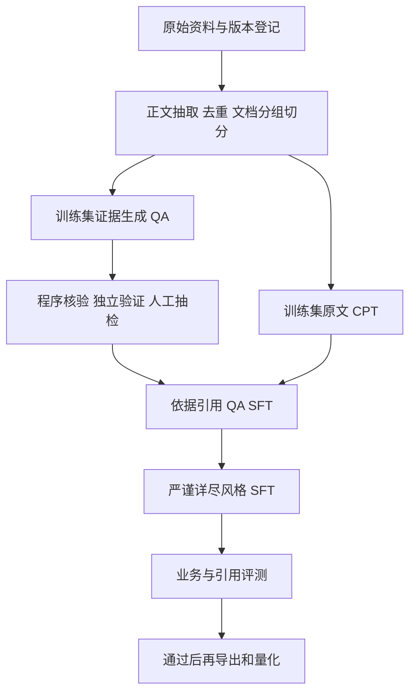

# 领域知识、QA 合成与回答风格

这组方案对应新增目标：把法律法规、文章和 Wiki 用于领域适配，再通过有依据的问答训练，让模型形成**严谨详尽、带依据引用**的回答风格。当前交付为研究方案、数据示例、生成提示词和配置示例；没有采集真实语料或启动训练。

| 方案 | 解决什么问题 |
|---|---|
| [原文 CPT](domain_cpt_plan.md) | 法规、文章、Wiki 如何整理、混合、分词、训练及评测 |
| [推理生成 QA](qa_synthesis_plan.md) | 如何从来源生成题目、作答、验证与导出 SFT 数据 |
| [回答风格 SFT](answer_style_sft_plan.md) | 如何学习详尽且有引用的回答，而非只增加字数或引用外观 |
| [27B 进阶训练与管理](qwen35_27b_advanced_training_and_management.md) | QAT/QLoRA、WSD 末期降 LR、新 Megatron 支持、原生配置与文件/产物管理 |

可检查的文件位于 [training/domain_adaptation/](../../training/domain_adaptation/README.md)，包含合成示例、来源记录、提示词和建议配方。它们不是生产数据或已验证的训练启动器。

新增格式依据 2026-11-08 的 SWIFT 4.7.0.dev 文档核对；执行时仍须固定目标机的精确版本/commit。原 V1～V4 流水线的既有环境与配置不因此自动升级。

对于需要随法规更新、给出准确出处的应用，推理端同时保留可更新的检索资料库。CPT 用来适配领域分布，SFT 教会使用材料和呈现依据；二者都不能单独保证记住最新法条或生成正确链接。量化在内容、引用和风格评测通过后进行。
