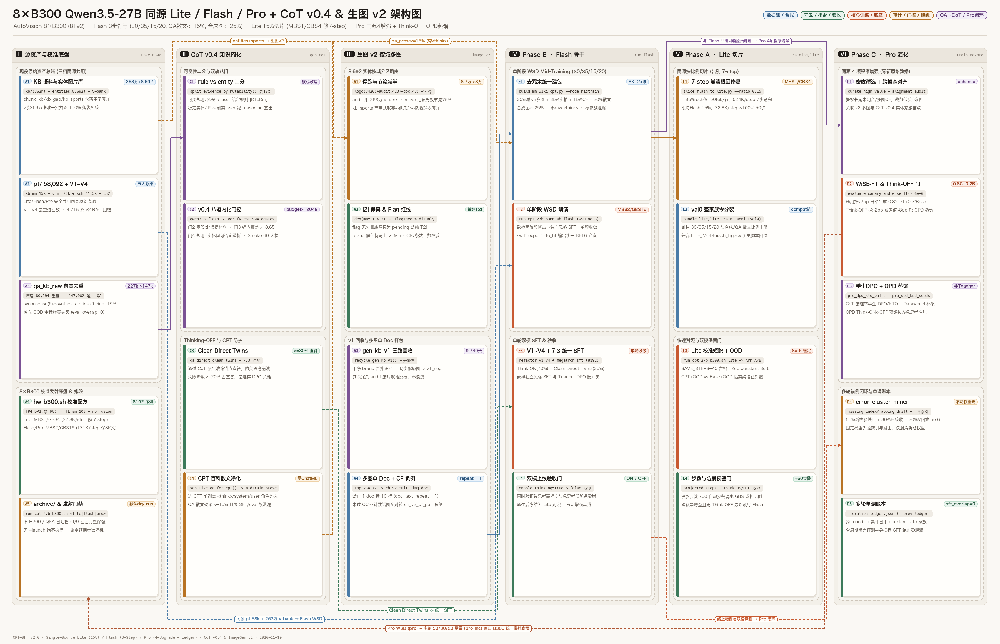
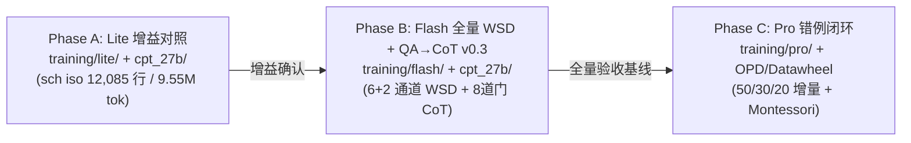

# 领域知识、CPT 与 QA/CoT 训练方案总览

围绕实际线上 IP 审核模板与 AutoVision 8×B300（`sm_103`）战役，当前方案按 **Lite（增益对照） → Flash（全量 WSD + QA→CoT v0.3） → Pro（错例闭环 + Montessori）** 三档分文件夹组织，历史 H200 / QSA 实验已归档至 [`archive/`](../../archive/README.md)。

- 三档工作流程总纲：[Lite、Flash 与 Pro 工作流程](online_ip_template_cpt.md)
- 前序 v2.1 6 通道 WSD 管线图（Flash 阶段细节）：[`flash/assets/b300_27b_cpt_sft_pipeline.png`](flash/assets/b300_27b_cpt_sft_pipeline.png)

## 一、Phase A：Lite 增益对照 ([`lite/`](lite/README.md))

| 文档 / 脚本 | 解决什么问题 |
|---|---|
| [CPT-27B 战役 Runbook（lite 增益对照线）](lite/cpt_27b_runbook.md) | 实测 `bundle_lite_v3_all·val0`（12,085 行 / 9.55M tok）、`sch iso` 改造规则、APEX/TE `sm_103` 排雷与双臂外部 OOD SFT 对照 |
| [`training/lite/build_cpt_from_sch.py`](../../training/lite/build_cpt_from_sch.py) | `sch` 原子自拼、`elements` 通道判定、`T1_FULL` KB 筛选与 `val0` 构建 |
| [`training/cpt_27b/run_cpt_27b_b300.sh`](../../training/cpt_27b/run_cpt_27b_b300.sh) | 权威 B300 统一发射入口（`lite` / `stage1` / `stage2` / `pro`，默认 dry-run，`--launch` 实发） |

## 二、Phase B：Flash 全量 WSD 与 QA→CoT v0.3 ([`flash/`](flash/README.md))

| 文档 | 解决什么问题 |
|---|---|
| [QA→CoT 逆向桥接详案（v0.3）](flash/qa_cot_plan.md) | 227,656 条 `qa_kb_raw.jsonl`、`qwen3.8-flash`（thinking ≥ 2048）、冷酷核验风格三禁、八道质检门、动态长度下限硬门（180/350/500）与 8:2 三方对照 |
| [B300 双模型多模态 Wiki+RAG CPT](flash/b300_multimodal_wiki_rag_cpt_plan.md) | 27B vs Flash-Next 可行性、TP4/DP2 GQA 整除约束、全量多通道 WSD 与 Qwen-Image 2.1 反事实规范 |
| [V1～V4 融入 CPT 与统一 QA-SFT 重构方案](flash/unified_v1_v4_cpt_qa_pipeline.md) | 历史 V1～V4 三元去重分流进 CPT 回放/RAFT，及三方 SFT 监督 Token 重平衡 |
| [推理生成 QA](flash/qa_synthesis_plan.md) | 源文档驱动 QA 合成、程序偏移/Hash 核验与独立语义验证 |
| [回答风格 SFT](flash/answer_style_sft_plan.md) | 严谨详尽、带 `[S1]` 依据引用的机构化回答规范与 2000 条风格收尾 |

## 三、Phase C：Pro 错例闭环演进 ([`pro/`](pro/README.md))

| 文档 | 解决什么问题 |
|---|---|
| [Pro 错例簇闭环演进方案](pro/pro_closed_loop_plan.md) | 四类错例归因（固定权重补索引/改路由优先）、50/30/20 增量 CPT、`sft_overlap=0` 隔离与 Montessori / OPD / Datawheel 闭环 |
| [27B 进阶训练与管理](pro/qwen35_27b_advanced_training_and_management.md) | QAT、NF4 QLoRA、WSD 公式与新 Megatron 堆栈调研参考 |

## 四、历史归档 ([`archive/`](../../archive/README.md))

- H200 `ms-swift 4.3.2` 三阶段 V1～V4 推荐线、H200 纯文本 CPT 草案及 35B-A3B QSA/Muon 实验均已归档至 [`archive/`](../../archive/README.md)。
