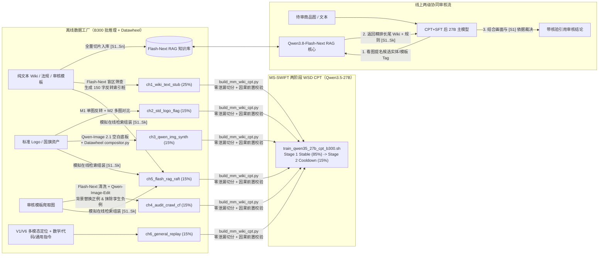

# B300 双模型（27B CPT + Flash-Next RAG）× Qwen-Image 2.1 多模态中训练方案

> 方案日期：2026-11-15。面向当前混合资产现状：**纯文本 Wiki/法规/文章为主 + 标准 Logo/国旗图 + 按审核模板爬取的业务图片**，协同 **`Qwen3.8-Flash-Next` RAG 检索中枢**与 **`Qwen-Image 2.1` 生图/编辑管线**，在 **8×B300** 节点上执行兼顾长尾知识写入与推理防退化的系统性多模态 CPT。
>
> **验证边界声明**：本方案与配套配置/脚本已完成参数对齐、数据契约构造、`DRY_RUN=1` 命令生成与标准库单元测试；**尚未在真实 B300 集群加载模型权重或启动 GPU 实训**。吞吐、显存估算与收敛阈值须经 10 步 smoke 与 100M token pilot 实测标定。

---

## 1. B300（8×288 GB HBM3e）训练可行性评估：`Qwen3.5-27B` vs `Qwen3.8-Flash-Next`

NVIDIA B300 单卡具备 288 GB HBM3e（8 卡单机共约 2.3 TB 显存），但两款模型在架构、显存与训练动力学上存在本质差异（结构参数依据 [27B 结构详解](../model_guide/qwen35_27b_architecture.md) 与 [Flash-Next 结构范围](../model_guide/model_structure_and_training_scope.md)）：

| 评估维度 | `Qwen3.5-27B`（及同构 `Qwen3.6/3.8-27B`） | `Qwen3.8-Flash-Next`（`qwen4_exp`） |
|---|---|---|
| **架构与参数** | **27B Dense**（64 层：48 GDN + 16 FullAttn；每层稠密 FFN 合计 17.1B） | **180B 总参 / 6B 激活**（48 层：36 GDN + 12 QSA；512 路由专家 + **51B PLE 表** + 4B MTP） |
| **BF16 静态权重** | 约 **54 GiB** | 约 **335 GiB**（主干 ~240 GiB + 51B PLE 表 **~95 GiB**） |
| **8×B300 全参 CPT 可行性** | ✅ **高（充裕）**：全参训练态（权重+梯度+优化器）约 432 GB，8 卡分摊后单卡占用可控，仍留有充足空间跑 `16K` 图文 Packing | ❌ **受限极重（不建议）**：全参态理论需 ~2.88 TB（超出 8×B300 总显存）；开启 `PLE_CPU_OFFLOAD=1` 时 **51B N-gram 表被框架冻结**，无法全参刷新表记忆 |
| **8×B300 LoRA CPT 可行性** | ✅ **极高**：单卡可跑，8 卡可直接 `TP=1, DP=8`（或 `TP=2/4`）高速扩展，支持 `r=64~128` 深层 MLP 高秩 LoRA | ⚠️ **仅限轻量 SFT / 格式适配**：依赖 `TP=2, EP=4, PP=2`；上游默认 LoRA（`in_proj/out_proj/linear_qkv`）不覆盖 512 专家 FFN |
| **算子与稳定性风险** | KV heads=4（兼容 `TP=1/2/4`）；无路由坍缩问题；结构同构于 `Qwen3.6/3.8-27B` | QSA 的 KV heads=2（`TP` 上限受制为 2）；512 专家长程无监督 CPT 易发生**路由坍缩**；强依赖特定 `mcore-bridge` 与 `FLA` 版本 |

### 1.1 硬件排兵结论：双模型各司其职

1. **`Qwen3.5-27B`（主攻多模态 CPT 的底座）**：承担**跨模态视觉接地、长尾实体索引桩写入、反事实防误杀与看图调用 RAG 证据**的主力训练任务。同构的 `Qwen3.6/3.8-27B` 可复用相同模块映射与切分逻辑（权重分布与量化仍须单独校验）。
2. **`Qwen3.8-Flash-Next`（造数裁判 + 在线 RAG 中枢 + 轻量格式适配）**：
   - 利用其 **6B 激活高速推理 + 51B PLE 对稀有词条的原生敏感度**，在离线阶段做 Wiki 盲区抽考、爬取图清洗和 RAG 证据组装；在在线阶段做多路召回重排核心（见 [serve_b300.sh](../../inference/serve_b300.sh)）。
   - 如需微调其 RAG 召回与引用遵循格式，仅使用 [train_b300_swift.sh](../../training/swift/train_b300_swift.sh) 跑 200～500 步轻量 LoRA SFT，不拿它扛亿级图文 CPT。

---

## 2. 顶层协同架构：CPT 参数索引桩 × Flash-Next RAG × Qwen-Image 2.1

为了避免把数百万字长尾百科硬塞进参数导致模型“背书变蠢”，本方案确立 **“参数记索引与视觉映射，RAG 存全文与动态规则”** 的分工：



---

## 3. 六通道（`channel`）数据规范与防降智长尾机制

所有通道均导出为 MS-SWIFT `pt` 标准格式（单条 `assistant` 消息 + `channel` 字段供 `--enable_channel_loss true` 分通道监控），由 [`build_mm_wiki_cpt.py`](../../training/domain_adaptation/build_mm_wiki_cpt.py) 统一校验、切分与混配。示例见 [`cpt_mm_6ch_example.jsonl`](../../training/domain_adaptation/examples/cpt_mm_6ch_example.jsonl)。

### 3.1 六通道配比（按非 Padding Token 计）

| 通道 (`channel`) | Stage 1 占比 | 数据来源与构造要点 | 解决的核心问题 |
|---|---:|---|---|
| **`ch1_wiki_text_stub`** | **25%** | **盲区筛查 + 长尾反转索引桩**：先用底座闭卷抽考，砍掉 80% 已熟知的头部百科常识；对盲区长尾词条不喂流水账，压缩为 **150 字以内的「特征/属性线索 → 标准实体名 + 别名 + 模板归属」反转桩**，并附加“未知长尾 vs 已知头部”对比挂靠 | 破除 Reversal Curse，让长尾通过已知锚点写入权重而不占用过多容量 |
| **`ch2_std_logo_flag`** | **15%** | **标准 Logo/国旗图元**：M1 单图正向接地 + M2 基于颜色/几何/dHash 近邻的多图并排易混辨析（如左绿右橙爱尔兰 vs 左橙右绿科特迪瓦） | 建立标准矢量/官方图元与实体的精确跨模态映射 |
| **`ch3_qwen_img_synth`** | **15%** | **`Qwen-Image 2.1` + `Datawheel` 合成实物**：遵循 [Qwen-Image 2.1 管线](../../../Datawheel/docs/QWEN_IMAGE_2_1_PIPELINE.md) 铁律——扩散模型只生成空白商品/载体底板并通过 OCR/手部门禁，再由 `compositor.py` 确定性贴附长尾 Logo/国旗，保留 100% 真值 BBox | 解决长尾标志“只有 1 张扁平标准图、缺真实商品穿戴/褶皱载体”的泛化短板 |
| **`ch4_audit_crawl_cf`** | **15%** | **审核模板爬取图 + 反事实孪生**：① 用 `Flash-Next` 过滤脏图、补充纯客观画面描述并标出违规局部；② 用 `Qwen-Image-Edit --protect-bbox` 替换背景与光照消除爬虫场景捷径；③ 用 `Qwen-Image-Edit` **抹除/遮挡违规标志生成“孪生反事实负例”** | 对齐真实业务画质与审核模板，借由 [CW-OPD](../../../../Study/Paper/2609.38777_CW-OPD跨世界蒸馏视觉证据/study_notes.md) 孪生对比抑制误杀 |
| **`ch5_flash_rag_raft`** | **15%** | **RAFT 式检索协同序列**：在同一条文本内依次串联 `视觉观察与检索词提名 → [Flash-Next 检索证据 S1..Sk（含 1 条干扰块）] → 结合画面与 [S1] 的核验结论` | 教会 27B 看图提出准确 RAG Query 并忠实消费 `Flash-Next` 检索证据 |
| **`ch6_general_replay`** | **15%** | **防退化硬回放**：V1/V6 细粒度视觉定位回放（8%）+ 数学/代码/高难多步指令回放（7%） | 在每一步 Global Batch 内锁死原有推理智商与 BBox 定位精度 |

### 3.2 三条数据硬红线（程序强制校验）

1. **`<image>` 前置因果掩码铁律**：自回归注意力是单向的。样本中 `<image>` 占位符**必须放在实体名、视觉描述与结论之前**（允许仅前置 `图1：`、`待审图：` 等短标签），严禁出现 `“爱尔兰国旗：<image>”`，确保模型在预测属性词与实体名时能直接 Attend 到图像 token。
2. **`Qwen-Image 2.1` 生成上限与禁止直接绘标**：严禁让扩散模型直接绘制目标品牌 Logo 或国旗正文；`ch3` 与 `ch4` 中扩散编辑图总计控制在总语料的 **20%–25% 以内**，且每张生成/编辑图必须通过 `tools/qwen_image_ops.py verify` 尺寸、保护区像素差与无新增文字校验。
3. **文档族零泄漏切分**：同一个 Wiki 词条（含多语言版本、反转桩、头部对比）或同一个实体/底板生成的合成图共享 `doc_family_id`。必须在采样或切块前先按 `doc_family_id` 划出 `val`（建议 2%），验证集文档族绝不流入 Stage 1、Stage 2 或下游 SFT。

---

## 4. MS-SWIFT 训练策略与两阶段 WSD 课程

### 4.1 后端入口与模块解冻策略

对应启动脚本：[`training/domain_adaptation/train_qwen35_27b_cpt_b300.sh`](../../training/domain_adaptation/train_qwen35_27b_cpt_b300.sh)，独立原生配置示例位于 [`training/domain_adaptation/examples/configs/`](../../training/domain_adaptation/examples/configs/)：

- **默认后端（`BACKEND=megatron`，`megatron pt`）**：适用 8×B300 大规模 WSD 训练（`TP=2/4, PP=1, DP=4/2`, `MAX_LENGTH=16384`, `GLOBAL_BATCH_SIZE=64`, `packing=true`, `padding_free=true`）。
- **轻量备选后端（`BACKEND=swift`，`swift pt`）**：适用单卡/多卡 BF16 深层 LoRA 快速探针。
- **模块范围（依据 [OPD 正交子空间路由](../../../OPD/depth_lora_router.py)）**：
  - **`ViT`**：保持冻结（`--freeze_vit true`），避免爬虫低质图与编辑图损伤底层视觉表征。
  - **`Aligner (Merger)`**：**开启微调**（`--freeze_aligner false --aligner_lr 5e-6`），让视觉投影随 LLM 实体空间同步微调，防止跨模态断层。
  - **`LLM 主干`**：
    - **保守无损线（首选验证）**：使用 BF16 **LoRA CPT**（`r=64, alpha=128`），或通过 `LORA_SCOPE=deep_mlp_regex`（或 Megatron `TARGET_REGEX`）重点给后 2/3 层（第 22–63 层）MLP 与 Merger 分配高容量更新，尽量隔离前中层推理路由。注意 Megatron 模块名（`linear_fc1/linear_fc2`）与 HF（`gate_proj/up_proj/down_proj`）不同，必须先用 [`tools/check_target_regex.py`](../../tools/check_target_regex.py) 对目标进程的 `named_modules()` 验证后再上正则。
    - **大容量写入线**：当盲区长尾总量超过数亿 token 且 LoRA 训练 loss 降不动时，切换 `TUNER_TYPE=full`（`lr=1e-5 -> 1e-6`）。

### 4.2 两阶段 WSD 课程（Warmup → Stable → Cooldown）

对齐 [27B 进阶训练方案 §4](qwen35_27b_advanced_training_and_management.md#L71-L100)：

1. **Stage 1（Stable 期，前 85% 预算）**：
   - 使用 6 通道标准配比（`25 : 15 : 15 : 15 : 15 : 15`），学习率经 3% warmup 升至峰值后保持恒定（LoRA `2e-5` / 全参 `1e-5`）。
   - 跑完后保留完整优化器与 RNG 检查点（`--no_save_optim false --no_save_rng false`），对训练集中长尾实体做一次闭卷+看图抽考，标出未掌握的 `is_unresolved_tail` 实体。
2. **Stage 2（Cooldown 线性退火期，后 15% 预算）**：
   - `lr_decay_style=WSD` 进入线性退火（降到峰值 10%），同时通过 `build_mm_wiki_cpt.py` 生成 Stage 2 退火数据集：**降采样已学会的头部条目，对未记住的顽固长尾反转桩做 2× 过采样**，并拉高 `ch4_audit_crawl_cf`、`ch5_flash_rag_raft` 与 `ch6_general_replay` 比例以固化RAG调用与通用智商。
3. **接续后训练**：CPT 产物（HF safetensors 或合并后 checkpoint）作为底座，接一轮 1 epoch 的 [Montessori QA](qa_synthesis_plan.md) 与 [严谨引用风格 SFT](answer_style_sft_plan.md)，激活闭卷提名与带 `[S1]` 依据的审核表达。

---

## 5. 四维门禁与防降智回滚护栏

每 100 步与 Stage 1/2 交界处必须同时汇报以下 4 项指标（缺一不可）：

| 维度 | 评测内容 | 验收与熔断阈值（按基线对比） |
|---|---|---|
| **1. 视觉提名召回（Recall@3）** | 仅看标准图或审核爬取图，不给文本提示，能否在前 3 个候选词里命中目标实体或审核模板 Tag | 决定 `Flash-Next` RAG 能否被正确触发；长尾集应较基座显著抬升 |
| **2. 反事实防误杀率** | 在 `Qwen-Image-Edit` 抹除标志的孪生负样本与 `Datawheel` Stage E 遮挡/干扰样本上的拒报/正常判别准确率 | 不得因写入大量审核模板而出现大规模误报退化 |
| **3. RAG 端到端审核 F1** | 接入 `Qwen3.8-Flash-Next` 检索回来的 `[S1..Sk]`（含 1 条强干扰文档）后的最终判断与引用支持率 | 衡量图+文证据联合推理收益，区分“没找对”与“找到但没用上” |
| **4. 通用能力防变蠢基线** | 原有业务 `eval_v3`（5658 口径）与通用推理/数学/代码子集准确率及 `val_general` NLL | 一旦出现明显连续滑坡，立即回退前档，或使用 LoRA `scaling`（如 `0.7~0.8`）回调干预 |

---

## 6. 本地检查与落地命令

在仓库根目录 `Coding/CPT-SFT/` 执行（全部支持无 GPU 本地验证）：

```bash
# 1. 构造 6 通道示例/真实 CPT 混合集与 WSD 两阶段分片
python3 training/domain_adaptation/build_mm_wiki_cpt.py --demo \
  --output-dir /tmp/mm_cpt_demo

# 2. 校验 B300 27B CPT 启动命令（megatron pt WSD & swift pt 深层 LoRA）
DATASET=/tmp/mm_cpt_demo/stage1_train.jsonl VAL_DATASET=/tmp/mm_cpt_demo/val.jsonl \
  BACKEND=megatron TUNER_TYPE=full TRAIN_ITERS=1000 LR_DECAY_STYLE=WSD DRY_RUN=1 \
  bash training/domain_adaptation/train_qwen35_27b_cpt_b300.sh

DATASET=/tmp/mm_cpt_demo/stage1_train.jsonl VAL_DATASET=/tmp/mm_cpt_demo/val.jsonl \
  BACKEND=swift TUNER_TYPE=lora LORA_SCOPE=deep_mlp_regex DRY_RUN=1 \
  bash training/domain_adaptation/train_qwen35_27b_cpt_b300.sh

# 3. 运行回归测试
python3 tests/test_b300_mm_cpt_pipeline.py -v
```
