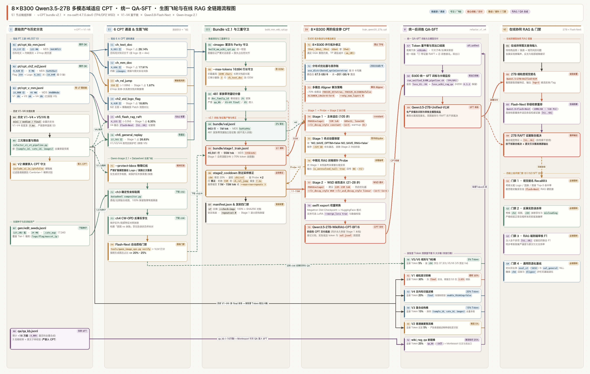
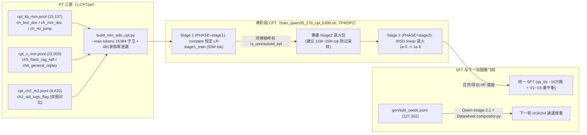

# B300 双模型（27B CPT + Flash-Next RAG）× Qwen-Image 2.1 多模态中训练方案

> 方案修订：2026-11-16（同步 `v-CPT` 远端最新数据台账 `bundle v2.1` 及 `tpz venv` `ms-swift 4.7.0.dev0` 源码旗标核对结论）。
> 面向当前混合资产现状：**知识库图文/长跨文档关联 + 标准 Logo/国旗双图对比 + V 系列回放升格 RAFT**，协同 **`Qwen3.8-Flash-Next` RAG 检索中枢**与 **`Qwen-Image 2.1` 生图/编辑管线**，在 **8×NVIDIA B300 SXM6 AC**（`sm_103`，`275,040 MiB` ≈ `268.6 GiB/卡`）节点上执行兼顾长尾知识写入与推理防退化的系统性多模态 CPT。
>
> **验证边界声明**：远端已完成 `v-CPT` 数据构建、MD5 对账与 `tpz venv` 参数源码核对，本地已完成 `build_mm_wiki_cpt.py` / `train_qwen35_27b_cpt_b300.sh` 的 `DRY_RUN=1` 与单元测试；**尚未在目标 B300 集群启动正式 GPU 实训**，所有真实吞吐与效果收敛须以 10 步 smoke 和正式评测为准。



---

## 1. B300（8×268.6 GiB HBM3e）训练可行性与硬件拓扑修正

### 1.1 `Qwen3.5-27B` vs `Qwen3.8-Flash-Next` 分工定位

结构参数依据 [27B 结构详解](../../model_guide/qwen35_27b_architecture.md) 与 [Flash-Next 结构范围](../../model_guide/model_structure_and_training_scope.md)：

| 评估维度 | `Qwen3.5-27B`（及同构 `Qwen3.6/3.8-27B`） | `Qwen3.8-Flash-Next`（`qwen4_exp`） |
|---|---|---|
| **架构与参数** | **27B Dense**（64 层：48 GDN + 16 FullAttn；每层稠密 FFN 合计 17.1B） | **180B 总参 / 6B 激活**（48 层：36 GDN + 12 QSA；512 路由专家 + **51B PLE 表** + 4B MTP） |
| **BF16 静态权重** | 约 **54 GiB** | 约 **335 GiB**（主干 ~240 GiB + 51B PLE 表 **~95 GiB**） |
| **8×B300 全参 CPT 可行性** | ✅ **高（充裕）**：TP4/DP2 + Distributed Optimizer 下每卡静态态仅 **~67.5 GB**，仍留有 **~201 GB/卡** 给 `16K` 图文激活 | ❌ **受限极重（不建议）**：全参态理论需 ~2.88 TB（超出 8×B300 总显存）；开启 `PLE_CPU_OFFLOAD=1` 时 **51B N-gram 表被框架冻结** |
| **8×B300 LoRA CPT 可行性** | ✅ **极高**：支持全参或深层 MLP 高秩 LoRA（`r=64~128`）高速扩展 | ⚠️ **仅限轻量 SFT / RAG 格式适配**：依赖 `TP=2, EP=4, PP=2`（见 [train_b300_swift.sh](../../../training/swift/train_b300_swift.sh)） |

### 1.2 ⚠️ 并行拓扑勘误：`TP=4, DP=2`（禁止盲设 `TP=8`）

- **GQA 头整除硬约束**：`Qwen3.5-27B` 的 16 层全注意力仅有 **4 个 KV 头**（`num_key_value_heads=4`）。在标准 Megatron-Core 下设 `TP=8` 会触发 `4 % 8 != 0` 整除报错（或被迫跨卡复制 KV 头浪费通信）。
- **显存与通信账**：开启 `use_distributed_optimizer=true` 时，FP32 优化器状态按全局 `TP × DP = 8` 均摊。采用 **`TP=4, PP=1, DP=2`（或 `TP=2, DP=4`）** 时：
  - 单卡占用：`54/4 = 13.5 GB`（BF16 权重）+ `13.5 GB`（梯度）+ `324/8 = 40.5 GB`（分布式 FP32 优化器状态）= **`67.5 GB/卡`**；
  - 剩余 **`~201 GB/卡`** 可轻松支撑 `MAX_LENGTH=16384`、甚至在 preflight 验证后将 `MICRO_BATCH_SIZE` 提至 `2` 或 `4`，且跨卡 TP All-Reduce 通信量减半。
- **底座与算子预检**：
  - 发射前需由主控在三大变体（`Quad` / `Quad-Jev` / `Quad-Jev-vllm`）中正式钦定基座路径；
  - B300 为 `sm_103`，Megatron 侧默认尝试 `ATTENTION_BACKEND=flash`（TE-flash）；若 10 步 preflight 出现内核兼容问题，直接通过环境变量 `ATTENTION_BACKEND=unfused` 回退保底；
  - 设 `MTP_NUM_LAYERS=0` 时 CPT 保存权重不含 `model_mtp.safetensors`；若选用 `Quad-Jev-vllm` 且上线需 MTP 投机解码，需在后训练补齐或推理端关闭 MTP。

---

## 2. 远端 `v-CPT` 最新数据台账与协同架构

### 2.1 `v-CPT` 现役资产盘点（截至 2026-11-16 `bundle v2.1`）

| 资产文件 | 规模 | MD5 | 通道构成与状态 |
|---|---|---|---|
| `pt/cpt_kb_mm.jsonl` | 15,137 行（123 MB） | `36830f23` | `ch_text_doc` 9,883 / `ch_mm_doc` 4,696 / `ch_rel_jump` 558（logo 池 + pokemon dex，✅ 图齐） |
| `pt/cpt_v_mm.jsonl` | 22,000 行（45 MB） | `99d006de` | `ch5_flash_rag_raft` 4,235 / `ch6_general_replay` 17,765（v1 8k + v3 6k + v4 8k，排除 v5；⚠️ 等 v7 图回填） |
| `pt/cpt_ch2_m2.jsonl` | 9,420 行（9 MB） | `4a492ba3` | flag 对 259 + logo 对 9,161（双图 `<image>`×2，18,840 次存在性 0 缺，✅ 图齐） |
| `bundle/stage1_train.jsonl` | 45,591 行 / **55M tok** | `335b3e82` | Stage 1 自然混配训练集（`length_guard --max-tokens 16384` 已审计删 3 行 `ch_text_doc`） |
| `bundle/stage2_cooldown.jsonl` | 45,592 行 / **55M tok** | `6fbc1813` | Stage 2 知识浓相退火包（⚠️ 见 §3.2 过采样修正建议） |
| `bundle/val.jsonl` | 963 行 / **1M tok** | `ba95a99a` | 481 个 doc 家族零泄漏验证集（2%，绝不混入训练） |
| `bundle/manifest.json` | — | `c5b0a28a` | SHA256 + 逐通道 token 对账 + `length_guard` 审计 |
| `qa/qa_kb.jsonl`（合成中） | 预计 **~16 万题** | — | 8,005 docs 全量合成（3 风格轮转 + 原文子串校验），**仅供 SFT 阶段使用，不进 CPT** |
| `gen/edit_seeds.jsonl` | **127,202 粒**（24 MB） | `9290ec27` | 覆盖 16,721/17,343 cate（`.cate_map.json` 全命名 17,343），下一轮接 `Qwen-Image 2.1` 生 `ch3/ch4` |

### 2.2 现役与下轮协同流程



---

## 3. 六通道配比、行长守卫与防过采样修正

由 [`build_mm_wiki_cpt.py`](../../../training/flash/build_mm_wiki_cpt.py) 统一校验（`<image>` 置顶因果掩码、占位符 parity、`doc_family_id` 零泄漏切分、`--max-tokens 16384` 行长守卫与重复倍率审计）。示例见 [`cpt_mm_6ch_example.jsonl`](../../../training/flash/examples/cpt_mm_6ch_example.jsonl)。

### 3.1 现役 6 通道 Token 占比（`bundle v2.1` 实测 vs 建议修正）

| 通道 (`channel`) | 原始源池规模 | Stage 1 自然占比 | Stage 2 原设占比 | 审阅风险与对策 |
|---|---:|---:|---:|---|
| **`ch_text_doc`** | 9,883 行 | **28.14%** | **20.05%** | 主题知识主干；含长跨段文，`--max-tokens 16384` 下删 3 超长行 |
| **`ch6_general_replay`** | 17,765 行 | **26.83%** | **19.99%** | 护栏回放池；建议保留 ≥20% 防止语言与原本定位能力退化 |
| **`ch2_std_logo_flag`** | 9,420 行 | **18.80%** | **10.01%** | 双图 M2 对比（flag 259 + logo 9,161），硬难例辨析核心 |
| **`ch_mm_doc`** | 4,696 行 | **17.91%** | **15.01%** | 图鉴与图文实证词条，跨模态接地核心 |
| **`ch5_flash_rag_raft`** | 4,235 行 (~3.5M tok) | **6.35%** | **20.03%** | ⚠️ 55M 口径下重复 ~3.1 倍（两阶段合计 ~4.1 遍） |
| **`ch_rel_jump`** | 558 行 (~1.08M tok) | **1.97%** | **14.91%** | 🚨 **高过拟合风险**：55M 口径下 558 行被重复 **~7.6 倍（累计 ~8.6 遍）**！ |

### 3.2 ⚠️ Stage 2 规模与过采样修正建议（二选一）

`stage1_train` 已过完 45,591 行（55M tok = 1 epoch）。若 Stage 2 再以同样 55M tok 规模重采样，`ch_rel_jump` 等稀缺通道会被严重背诵模板化：
- **修正方案 A（推荐，符合 WSD 15%～20% 退火比例）**：将 **Stage 2 退火包总预算缩至 `11M～15M tok`**（约 21～28 步，`STAGE2_DECAY_ITERS=21~28`）。此时 `ch_rel_jump` 占 15% 仅需 ~1.65M tok（单阶段重复仅 **~1.5 倍**），既完成了浓相分布收尾，又避免过拟合背书。
- **修正方案 B（若坚持 Stage 2 跑满 55M tok）**：在 `build_mm_wiki_cpt.py` 启用 **`--max-row-repeats 3`**，强制任一通道单行重复不超过 3 倍，多出的 token 份额按比例分摊给体量充裕的 `ch_text_doc` / `ch_mm_doc` / `ch6_general_replay`，并通过 `manifest.json` 中的 `effective_repeat_factor` 与 `warnings` 审计。

### 3.3 下一轮 `Qwen-Image 2.1` 扩增通道（`ch3` / `ch4`）

待 `v7` 图回填及 `gen/edit_seeds.jsonl`（127,202 粒）接入 [Qwen-Image 2.1 管线](../../../../Datawheel/docs/QWEN_IMAGE_2_1_PIPELINE.md) 与 [compositor.py](../../../../Datawheel/engine/compositor.py) 后，遵循以下红线合入下一轮迭代：
1. **禁止扩散模型直接绘制 Logo/国旗正文**：仅生成空白底图或做 `--protect-bbox` 保护区外背景替换 + 局部抹除（产出 [CW-OPD](../../../../../Study/Paper/2609.38777_CW-OPD跨世界蒸馏视觉证据/study_notes.md) 式反事实孪生负例）；
2. **比例上限与质检门禁**：生成/编辑图在总语料中占比不超过 20%–25%，且全量通过 `tools/qwen_image_ops.py verify` 与 `<image>` 置顶因果校验。

---

## 4. MS-SWIFT 实测旗标、训练稳定性与多模态解冻修正

对应启动脚本：[`training/cpt_27b/run_cpt_27b_b300.sh`](../../../training/cpt_27b/run_cpt_27b_b300.sh)（底层 [`train_cpt_qwen3_5_27b_megatron.sh`](../../../training/cpt_27b/train_cpt_qwen3_5_27b_megatron.sh)），参考 JSON 模板位于 [`training/flash/examples/configs/`](../../../training/flash/examples/configs/)。

### 4.1 已对 `tpz venv` (`ms-swift 4.7.0.dev0`) 核实的源码旗标约束

- `swift/megatron/arguments/megatron_args.py:566`：`lr_decay_style ∈ {constant, linear, cosine, inverse-square-root, WSD}`；
- `megatron_args.py:573`：**`lr_wsd_decay_style` 默认为 `exponential`，必须显式传入 `--lr_wsd_decay_style linear`**；
- `megatron_lm_utils.py:748`：`lr_decay_iters` 缺省自动等于实际 `train_iters`；`lr_wsd_decay_iters` 为优化器步数；
- 因为 megatron `get_lr` 中 `WSD` 的 `anneal_start = total - wsd_decay` 可能退化为负，**Stage 1（`PHASE=stage1`）必须使用 `--lr_decay_style constant`**（搭配 `--lr_warmup_fraction 0.06`），Stage 2（`PHASE=stage2`）另开退火分支使用 **`--lr_decay_style WSD --lr_wsd_decay_style linear --lr_wsd_decay_iters <实测步数>`**。

### 4.2 ⚠️ Stage 1→2 优化器动量与 `FREEZE_ALIGNER` 两项关键修正

1. **优化器动量衔接（修复冷启动 Gradient Spike）**：
   - 若 Stage 1 设 `NO_SAVE_OPTIM=true`，Stage 2 冷启动时 AdamW 一阶/二阶矩 $m_t, v_t$ 全零；此时若 Stage 2 设 `warmup=0` 且 `lr=1e-5`，前几步会产生近似符号阶跃更新，极易击穿刚收敛的权重。
   - **修正**：首选 Stage 1 设 **`NO_SAVE_OPTIM=false NO_SAVE_RNG=false`**（仅保留终点档约 ~324 GB/8卡），由 Stage 2 完整恢复动量再做 `warmup=0` 退火；若因磁盘空间限制必须不存优化器，则 Stage 2 必须开启 **`LR_WARMUP_FRACTION=0.05`（5% 缓冲升温）** 并将峰值降至 `5e-6`。
2. **~70% 多模态 Token 下的 `FREEZE_ALIGNER` 取舍**：
   - 现役 PT 池中 `ch_mm_doc` (17.91%) + `ch2_std_logo_flag` (18.80%) + `cpt_v_mm` (33.18%) 合计约 **70% token 含图像**。若全参更新 LLM 同时死锁 Merger，LLM 隐流形偏移后会导致视觉投影失配。建议在全参或高秩 LoRA CPT 时默认 **`FREEZE_VIT=true FREEZE_ALIGNER=false ALIGNER_LR=2e-6~5e-6`**，或以 `eval_v3` 对照验证是否需要冻结。

### 4.3 两阶段发射命令速查

```bash
# Stage 1：constant + 6% warmup（推荐 TP=4, GBS=32, 保留终点优化器状态）
PHASE=stage1 TUNER_TYPE=full TP_SIZE=4 GBS=32 NO_SAVE_OPTIM=false NO_SAVE_RNG=false \
  DATASET=/path/to/bundle/stage1_train.jsonl VAL_DATASET=/path/to/bundle/val.jsonl \
  bash training/domain_adaptation/train_qwen35_27b_cpt_b300.sh

# Stage 2：闭卷抽考标 is_unresolved_tail 并重建退火包（建议 11M~15M tok）后执行线性 WSD 退火
PHASE=stage2 TUNER_TYPE=full TP_SIZE=4 GBS=32 MODEL_PATH=<stage1_final_ckpt> \
  STAGE2_DECAY_ITERS=<启动日志实值> \
  DATASET=/path/to/bundle/stage2_cooldown.jsonl VAL_DATASET=/path/to/bundle/val.jsonl \
  bash training/domain_adaptation/train_qwen35_27b_cpt_b300.sh
```

---

## 5. 发射门禁与四维验收指标

**发射前四条硬门禁**（全满足方可发射）：
1. `v7` 图像下载回填完成，`build_pt_from_v.py --check-imgs` 校验 100% 通过；
2. 底座在 `Quad` / `Quad-Jev` / `Quad-Jev-vllm` 中正式钦定；
3. `bundle` 已过 `--max-tokens 16384` 行长守卫与 Stage 2 重复倍率审计（`effective_repeat_factor <= 3.0`）；
4. Stage 1 退火前档永久保留，Stage 2 另开分支独立登记父档、追加 token 与调度参数。

**四维评测门禁**（Stage 1 末档、Stage 2 末档及后续 SFT 后必测）：
1. **视觉提名召回（Recall@3）**：看图能否在前 3 个候选内命中长尾实体与模板 Tag（触发 `Flash-Next` RAG 的前提）；
2. **反事实防误杀率**：双图对照、孪生抹除负例及 `misleading` 簇拒报准确率；
3. **RAG 端到端审核 F1**：接入 `Flash-Next` 返回 `[S1..Sk]`（含干扰项）后的联合裁决与引文支持率；
4. **通用/旧业务防退化基线**：原有 `eval_v3`（5658 口径）与 `val_general` NLL 不得明显下滑。

---

## 6. 本地检查与验证命令

```bash
# 1. 运行带 length_guard 与重复倍率审计的 6 通道 Demo 构建
python3 training/domain_adaptation/build_mm_wiki_cpt.py --demo \
  --max-tokens 16384 --max-row-repeats 3 --output-dir /tmp/mm_cpt_demo

# 2. 校验 Stage 1 (constant) & Stage 2 (WSD linear) 启动命令与 TP 守卫
PHASE=stage1 TUNER_TYPE=full TP_SIZE=4 DATASET=/tmp/mm_cpt_demo/stage1_train.jsonl \
  VAL_DATASET=/tmp/mm_cpt_demo/val.jsonl DRY_RUN=1 \
  bash training/domain_adaptation/train_qwen35_27b_cpt_b300.sh

PHASE=stage2 TUNER_TYPE=full TP_SIZE=4 STAGE2_DECAY_ITERS=25 MODEL_PATH=/tmp/s1_ckpt \
  DATASET=/tmp/mm_cpt_demo/stage2_cooldown.jsonl VAL_DATASET=/tmp/mm_cpt_demo/val.jsonl DRY_RUN=1 \
  bash training/domain_adaptation/train_qwen35_27b_cpt_b300.sh

# 3. 运行单元测试
python3 tests/test_b300_mm_cpt_pipeline.py -v
```
