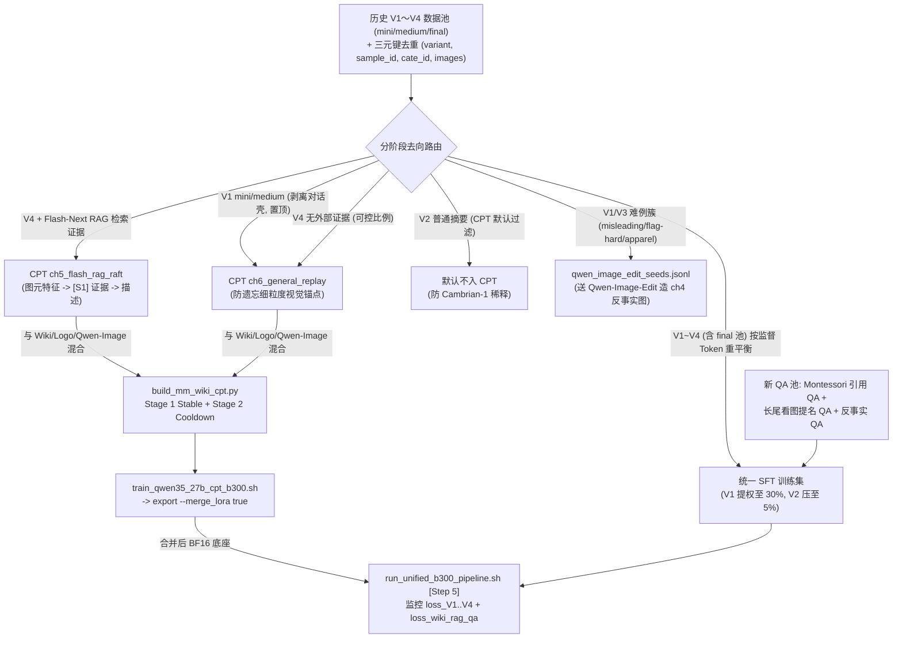

# V1～V4 重构方案：融入多模态 Wiki+RAG CPT 与统一 QA-SFT 流水线

> 编制日期：2026-11-16。本方案将原有的 V1～V4（含 V5/V6）业务多模态 SFT 数据池重构接入 [B300 多模态 Wiki+RAG CPT](b300_multimodal_wiki_rag_cpt_plan.md) 与 [Montessori QA / 引用风格 SFT](README.md)，形成统一的两段式流水线：**6 通道 WSD 多模态 CPT → 合并导出 → V1～V4 Token 重平衡 + 新 QA/RAG 统一 SFT**。
>
> **验证边界与兼容声明**：原 H200 `ms-swift 4.3.2` 三阶段冻结推荐线 [`training/qwen35_27b/`](../../training/qwen35_27b/README.md) 保持原样不破坏；本文及配套脚本已在本地通过三元去重校验、Token 重平衡构造、配置检查与 `DRY_RUN=1` 端到端测试，尚未在真实 B300 集群使用全量 Parquet 运行实训。

---

## 1. 为什么要重构 V1～V4，而不是直接重跑旧 S1～S3？

在历史日志 [progress_log.md](../history/progress_log.md) 中，旧 V1～V4 流水线存在 4 个结构性瓶颈：

1. **三阶段全是 SFT，不是真 CPT**：旧 S1/S2/S3 全部以对话模板只监督 assistant 答案，没有在 `pt` 模式下做长尾 Wiki 索引桩和跨模态因果前缀对齐。
2. **S3 行占比严重失衡且受 V2 稀释**：在旧 S3 `final` 池中，V1 仅占 3.65% 行数而 V3+V4 占 75.38%，且不同 variant 监督 token 密度差距巨大（V1 `632.2 tok/row` vs V2 `232.7 tok/row` vs V5 `83.1 tok/row`）。此外，V2 普通摘要 caption 过多会稀释细粒度实体识别。
3. **244 万行旧 SFT 会洗掉 CPT 新知识**：若在 B300 CPT 产物上原样重刷 244 万行旧 S1～S3，旧数据里不含 `Flash-Next` RAG 检索序列与 `Qwen-Image-Edit` 反事实孪生样本，模型容易出现“反向遗忘”。
4. **环境断代**：旧推荐脚本在 `train_s1_s3_recommended.py` 中硬锁 `ms-swift==4.3.2` 与 `megatron-core==0.18.0`，无法直接在 B300 的 `ms-swift 4.7.0.dev` 上执行。

---

## 2. 重构后的分流总览（V1～V4 的四路去向）

核心路由实现见 [`refactor_v1_v4_pipeline.py`](../../training/domain_adaptation/refactor_v1_v4_pipeline.py)，数据示例见 [`v1_v4_legacy_sample.jsonl`](../../training/domain_adaptation/examples/v1_v4_legacy_sample.jsonl)：



### 2.1 分阶段处理细则

| 原始数据 | 在新 **CPT（`pt`）** 阶段怎么用 | 在新 **统一 QA-SFT（`sft`）** 阶段怎么用 | 继承的防坑硬规则 |
|---|---|---|---|
| **V1**（细粒度结构化识别） | 从 `mini/medium` 抽样剥离 `user` 对话壳，将 `<image>` 严格置顶后入 `ch6_general_replay` | **保留完整多池并大幅提权**（默认目标占监督 token 的 **30%**），彻底修正旧 S3 仅 3.65% 的倾斜 | 严禁将 `final` 池提前放入 CPT，保留未见泛化验证 |
| **V2**（普通摘要描述） | **默认过滤不入 CPT**（`include_v2_in_cpt=false`），把显存与步数全留给长尾和 V1 | **限流点缀**（默认控制在监督 token 的 **5%**），防止稀释精确识别 | 按 assistant 监督 token 数控制配比，不按行数 |
| **V3**（复合结构+摘要） | 少量 `mini/medium` 转单条 `assistant` 入 `ch6`；同时抽取难例图清单供 `Qwen-Image-Edit` 生图 | 与新合成 QA 配合，保持结构化表达能力（目标 **15%**） | 保持 `(sample_id, cate_id, images)` 三元去重 |
| **V4**（定向知识描述） | 有 `rag_evidence` 映射时自动升级为 **`ch5_flash_rag_raft`**；无外部证据时轻量入 `ch6` | 重点保留（目标 **20%**），继续校验 **`final` 池必须 `enable_thinking=false`** | 同一 `sample_id` 下允许挂多张不同图（历史 48,248 多行 key） |
| **V5 / V6**（规则判断 / Datawheel） | V6 可直接入 `ch6`；V5 属 S1-seen replay 不入 CPT 验证集 | V5/V6 按 5% 各占少量通道监控，`V5` 禁止切进 `val` | 验证集零泄漏且不从 `V5` 切分 |
| **新合成 QA**（Montessori / Wiki / RAG / CF） | 先以原文/反转桩/RAFT 形态进入 `ch1`/`ch4`/`ch5` | 占监督 token **20%–30%**（通道 `wiki_rag_qa`），将 CPT 写入的索引激活成标准回答与 `[S1]` 引用习惯 | 必须先通过引文子串核验或反事实校验 |

---

## 3. 在 B300 上一键运行重构后流水线

统一端到端编排入口：[`run_unified_b300_pipeline.sh`](../../training/swift/run_unified_b300_pipeline.sh)，配套 SFT 原生配置示例：[`sft_27b_unified_v1_v4_qa_b300.json`](../../training/domain_adaptation/configs/sft_27b_unified_v1_v4_qa_b300.json)。

### 3.1 本地无 GPU 端到端 Dry-Run 验证

```bash
cd Coding/CPT-SFT
DEMO=1 DRY_RUN=1 bash training/swift/run_unified_b300_pipeline.sh
```

### 3.2 真实 B300 集群分步使用方式

1. **接入真实 V1～V4 Parquet（或 JSONL）与新 Wiki/QA 文件**：
   ```bash
   V1_V4_INPUTS="/data/v1mini.parquet /data/v3mini.parquet /data/v4mini.parquet /data/v1final.parquet /data/v4final.parquet" \
   WIKI_CPT_INPUTS="/data/wiki_stubs.jsonl /data/logo_flag_mm.jsonl /data/qwen_img_synth.jsonl" \
   NEW_QA_INPUTS="/data/montessori_sft.jsonl /data/wiki_rag_qa.jsonl" \
   CPT_TUNER_TYPE=lora BACKEND=megatron SMOKE=1 DRY_RUN=1 \
   bash training/swift/run_unified_b300_pipeline.sh
   ```
   *(注：若在远端读取 `.parquet`，需先确认训练环境已安装 `pyarrow`；同时若需将 V4 升级为 `ch5_flash_rag_raft`，可通过 `RAG_EVIDENCE_MAP=/data/v4_rag_evidence.json` 传入 `{sample_id: ["[S1] ..."]}` 映射。)*
2. **先跑 10 步 `SMOKE=1` 再全量开跑**：检查日志中 CPT 的 `ch1..ch6` 与 SFT 的 `loss_V1..V4`、`loss_wiki_rag_qa` 均有正常梯度，且无跨池数据泄漏后，设 `DRY_RUN=0 SMOKE=0` 正式启动。
