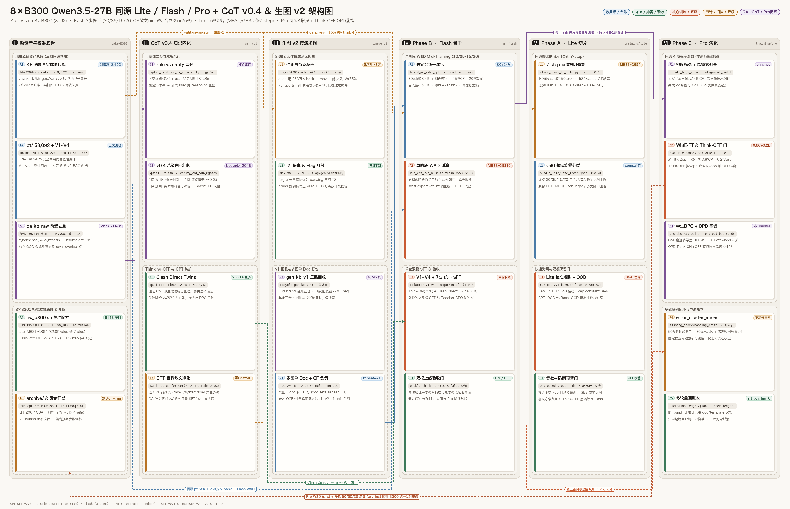

# 训练入口与目录分工

本仓库围绕 **AutoVision 8×B300 (`sm_103`) `Qwen3.5-27B`** 域适应主线，采用「**公共校准 B300 发射底盘 (`lib` + `cpt_27b`, 8192) + 同源递进 `Lite ← Flash → Pro` 三档流水线**」架构；历史 H200 与 35B-A3B QSA/Muon 实验已移入 [`archive/`](../archive/README.md)。

| 目录 | 定位与阶段 | 核心入口 | 说明 |
|---|---|---|---|
| [`lib/`](lib/hw_b300.sh) | **B300 公共层** | `_core.sh`、`hw_b300.sh` | 固化 `TP=4`、`MBS=2`、`GBS=16`、`MAX_LENGTH=8192`（Lite 覆写 `MBS=1/GBS=4`）、APEX `--gradient_accumulation_fusion false`、TE `sm_103` 预检 |
| [`cpt_27b/`](cpt_27b/run_cpt_27b_b300.sh) | **权威发射入口** | `run_cpt_27b_b300.sh`、`train_cpt_qwen3_5_27b_megatron.sh` | 统一承接 `lite` / `flash` / `pro` / `pro_inc`（并兼容 `stage1` / `stage2`），缺省 dry-run，传 `--launch` 实发 |
| [`lite/`](lite/README.md) | **Phase A：Lite 按比例切片对照** | `slice_flash_to_lite.py`、`run_lite_pipeline.sh` | 默认从 Flash 四桶 Mid-Training 池整家族按 `15%` 分层切片（`val0`、`MBS=1/GBS=4/8192` → 100~150 steps 告别 7-step 崩溃），保留 `sch_legacy` 回退与双臂 OOD SFT |
| [`flash/`](flash/README.md) | **Phase B：Flash 去冗余 3 步骨干** | `gen_cot_from_qa.py`、`build_v2_image_pipeline.py`、`build_mm_wiki_cpt.py`、`refactor_v1_v4_pipeline.py`、`run_flash_pipeline.sh` | CoT v0.4 知识内化 + `Clean Direct Twins` + CPT 百科散文；生图 v2 按域多图打包（`doc_text_repeat=1`）；单阶段 30/35/15/20 WSD Mid-Training（`synth<=25%`, `qa_prose<=15%`, 零 raw ChatML/<think>）；单轮双模 SFT |
| [`pro/`](pro/README.md) | **Phase C：Pro 同源增强 + 多轮演化** | `enhance_flash_to_pro.py`、`error_cluster_miner.py`、`montessori/`、`run_pro_pipeline.sh` | 复用 Flash 原始池执行 4 项程序增强（密度筛选、跨模态对齐、双模 Canary + WiSE-FT `0.8*CPT+0.2*Base`、学生 DPO/KTO + OPD Think-OFF 蒸馏）+ 多轮单调账本 `iteration_ledger.json`（`sft_overlap=0`） |
| [`swift/`](swift/README.md) | **单模型独立入口** | `train_b300_swift.sh`、`train_qwen35_27b_swift.sh` | `Qwen3.8-Flash-Next` B300 单独 LoRA 尝试与单卡 27B SFT |
| [`../archive/`](../archive/README.md) | **历史 H200 / QSA 归档** | `qwen35_27b_h200/`、`qsa_muon_35b_a3b/` | 原 H200×8 三阶段纯 SFT 与 35B-A3B QSA/Muon 实验 |

> 真实训练前仍须核对底座路径、数据 SHA256/MD5、启动日志 `train_iters`（防过短 7-step 崩溃）、`qa_cpt_risk_audit`（`raw_chatml_in_cpt_count==0`）与 `Think-ON` / `Think-OFF` 双模指标。
