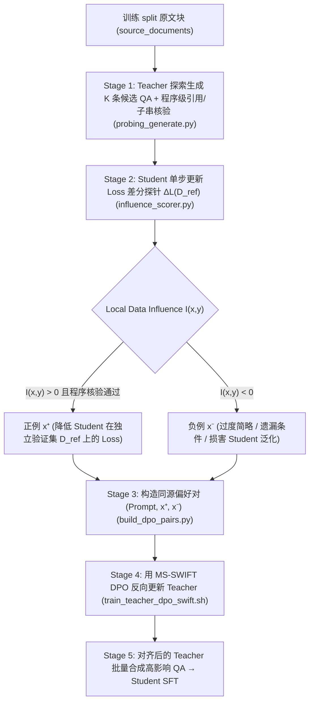

# Montessori-Instruct 领域 QA 合成管线（Student-Aware DPO 对齐）

基于 ICLR 2025 论文 [Montessori-Instruct: Generate Influential Training Data Tailored for Student Learning](https://arxiv.org/abs/2410.14208)，本模块将**局部数据影响函数（Local Data Influence）**与**教师 DPO 反向对齐**落地到 `CPT-SFT` 的**领域（法规/文章/Wiki）有据 QA 合成**流水线中。

---

## 1. 为什么在领域 QA 合成中引入 Montessori-Instruct？

在原有的 [推理生成 QA 方案](../../../docs/training_plans/qa_synthesis_plan.md) 中，Teacher 根据 `source_bundle` 生成候选问答并通过程序核验与独立验证器过滤。但这属于**后验过滤（Post-hoc Filtering）**——Teacher 并不知道 Student（如经过领域 CPT 后的 `Qwen3.5-27B` 或轻量级推理端模型）在阅读证据、保持法定但书条件、识别证据缺口（`answerable=false`）时到底欠缺什么能力。

本模块将开环合成升级为**五步闭环**：



---

## 2. 数学原理与工程实现对应

### 2.1 单步更新 Loss 差分（`one_step_loss_diff`，默认推荐）

原论文为了避免百亿参数模型上计算二阶 Hessian 逆矩阵向量积（HVP）的高昂代价，将影响函数一阶近似为**单步梯度更新前后的验证集损失差分（Local Data Influence）**：

$$\mathcal{I}(x_i, y_i; \mathcal{D}_{\text{ref}}) = \mathcal{L}(\mathcal{D}_{\text{ref}} \mid \theta) - \mathcal{L}\big(\mathcal{D}_{\text{ref}} \mid \theta - \eta \nabla_\theta \mathcal{L}(x_i, y_i \mid \theta)\big)$$

在 [`influence_scorer.py`](influence_scorer.py) 的 [`TorchStudentInfluenceEngine.score_candidates_one_step`](influence_scorer.py#L140-L180) 中：
1. **仅针对可训练子空间求导**：冻结视觉编码器与 Merger（`visual` / `merger`），仅对 Student 的 LoRA 权重或目标线性层求导，并在内存中保存一份精确的权重快照 `saved_weights`（LoRA 权重仅数十至数百 MB，无需复制整个 27B 基座）。
2. **仅监督 Assistant 回答**：通过 [`encode_assistant_supervised_example`](influence_scorer.py#L43-L75) 将 `system` 与 `user`（含原文块 `source_bundle` 和 `question`）的 label 设为 `-100`，仅计算 `assistant` 回答 token 的交叉熵损失。
3. **无优化器状态污染的原地探针**：对单条候选 $(x_i, y_i)$ 反向传播后，直接执行 `param.data.add_(param.grad, alpha=-probe_lr)`，前向评估独立验证集 $\mathcal{D}_{\text{ref}}$ 的平均 Loss，随后立即用 `param.data.copy_(saved_weights[name])` 精确回滚参数。

### 2.2 一阶梯度内积近似（`grad_dot`，大规模候选池加速）

当候选池规模扩大到数万条时，可通过 `--method grad_dot` 切换为一阶 Taylor 展开形式：

$$\mathcal{I}(x_i, y_i; \mathcal{D}_{\text{ref}}) \approx \eta \left\langle \nabla_\theta \mathcal{L}(\mathcal{D}_{\text{ref}} \mid \theta), \nabla_\theta \mathcal{L}(x_i, y_i \mid \theta) \right\rangle$$

[`score_candidates_grad_dot`](influence_scorer.py#L182-L230) 先在 $\mathcal{D}_{\text{ref}}$ 上累积一次平均梯度并缓存为 `ref_grads`，之后每条候选样本只需 **1 次反向传播 + 1 次向量点积**，无需重复前向遍历 $\mathcal{D}_{\text{ref}}$。

---

## 3. 文件清单与职责

| 文件 | 阶段 | 核心作用 |
|---|---|---|
| [`probing_generate.py`](probing_generate.py) | Stage 1 | 读取 `source_documents` JSONL，渲染 [`prompts/qa_generate.md`](../prompts/qa_generate.md)，调用 vLLM（或 `mock`）对每个原文块采样 $K$ 条候选 QA，并执行**程序级引用 Key、原文精确子串偏移（`start_char`/`end_char`）与 SHA256 核验** |
| [`influence_scorer.py`](influence_scorer.py) | Stage 2 | 计算每条候选 QA 对 Student 在独立验证集 $\mathcal{D}_{\text{ref}}$ 上的局部影响得分 $\mathcal{I}(x, y; \mathcal{D}_{\text{ref}})$，支持 `one_step_loss_diff` 与 `grad_dot` |
| [`build_dpo_pairs.py`](build_dpo_pairs.py) | Stage 3 | 按 `prompt_group_id` 聚合同一原文块的探测候选，配对正影响样本 $x^+$ 与负影响样本 $x^-$ 导出 MS-SWIFT DPO 训练集，同时导出高影响 Student SFT 数据集与来源溯源清单 |
| [`train_teacher_dpo_swift.sh`](train_teacher_dpo_swift.sh) | Stage 4 | 基于 `swift rlhf --rlhf_type dpo` 的 Teacher LoRA DPO 训练启动脚本（支持 `DRY_RUN=1` 预检与 RPO 正则项 `--rpo_alpha`） |
| [`run_montessori_pipeline.sh`](run_montessori_pipeline.sh) | Stage 1–5 | 端到端串联脚本：探索生成 → 影响打分 → DPO/SFT 数据构建 → Teacher DPO → Student SFT |

---

## 4. 快速开始与验证

### 4.1 本地无 GPU 端到端冒烟验证（Dry-Run）

在不依赖 GPU 和外部模型下载的环境下，可直接运行端到端编排脚本或单元测试，验证整条数据契约与命令生成：

```bash
# 1. 运行标准库单元测试（涵盖引文子串校验、伪造引用拦截、影响打分、DPO 配对与命令生成）
python3 tests/test_montessori_pipeline.py -v

# 2. 运行端到端流水线 Dry-Run
DRY_RUN=1 bash training/domain_adaptation/montessori/run_montessori_pipeline.sh
```

### 4.2 目标 GPU 机器实训流程（vLLM + PyTorch + MS-SWIFT）

在部署了 vLLM 推理服务与 PyTorch / MS-SWIFT 的 GPU 节点上：

```bash
# Step 1: 使用 vLLM 托管的 Teacher 对训练 split 原文块采样 K=4 条探测候选
API_BASE=http://127.0.0.1:8000 SERVED_MODEL_NAME=qwen35-27b \
python3 training/domain_adaptation/montessori/probing_generate.py \
  --sources /data/domain/train_sources.jsonl \
  --prompt-template training/domain_adaptation/prompts/qa_generate.md \
  --output /data/domain/montessori/probing_candidates.jsonl \
  --num-candidates 4 \
  --mode vllm

# Step 2: 在 Student 模型与独立验证集 D_ref 上计算单步更新 Loss 差分
python3 training/domain_adaptation/montessori/influence_scorer.py \
  --candidates /data/domain/montessori/probing_candidates.jsonl \
  --ref-dataset /data/domain/val_ref_messages.jsonl \
  --output /data/domain/montessori/scored_candidates.jsonl \
  --backend torch \
  --method one_step_loss_diff \
  --student-model /data/models/Qwen3.5-27B \
  --student-adapter /data/checkpoints/student_init_lora \
  --probe-lr 1e-4

# Step 3: 构建 Teacher DPO 偏好对与高影响 Student SFT 数据集
python3 training/domain_adaptation/montessori/build_dpo_pairs.py \
  --scored-candidates /data/domain/montessori/scored_candidates.jsonl \
  --dpo-output /data/domain/montessori/teacher_dpo_pairs.jsonl \
  --sft-output /data/domain/montessori/student_sft_messages.jsonl \
  --provenance-output /data/domain/montessori/student_sft_provenance.jsonl

# Step 4: 用 MS-SWIFT 对 Teacher 执行 DPO 反向对齐
DATASET=/data/domain/montessori/teacher_dpo_pairs.jsonl \
MODEL=/data/models/Qwen3.5-27B \
OUTPUT_DIR=/data/checkpoints/teacher_montessori_dpo \
bash training/domain_adaptation/montessori/train_teacher_dpo_swift.sh

# Step 5: 用对齐后的 Teacher 合成最终大规模 QA 并启动 Student SFT
DATASET=/data/domain/montessori/student_sft_messages.jsonl \
MODEL=/data/models/Qwen3.5-27B \
OUTPUT_DIR=/data/checkpoints/student_montessori_sft \
bash training/swift/train_qwen35_27b_swift.sh
```

---

## 5. 防泄漏与工程纪律（Guardrails）

1. **验证集文档族隔离**：$\mathcal{D}_{\text{ref}}$（`--ref-dataset`）必须来自独立的 `validation` 文档族（`doc_family_id` 与训练集无交集），绝不能把测试集（`test`）用作影响函数的参考集 $\mathcal{D}_{\text{ref}}$。
2. **先过硬核验、再选高影响**：只有同时满足 `checks.programmatic_valid == true`（引文 Key 存在且 `quote` 为原文精确子串）且 `influence.score > 0` 的样本才允许作为 DPO 的正例 $x^+$ 或进入 Student SFT，防止模型因为迎合验证集语言分布而奖励伪造引用的幻觉样本。
3. **RPO 长度与崩塌保护**：`train_teacher_dpo_swift.sh` 默认开启 `--rpo_alpha 0.1`（在 DPO 损失上叠加正例 $x^+$ 的 NLL 损失），防止 Teacher 在多轮 DPO 后出现 JSON 语法退化或输出概率双双下降。

